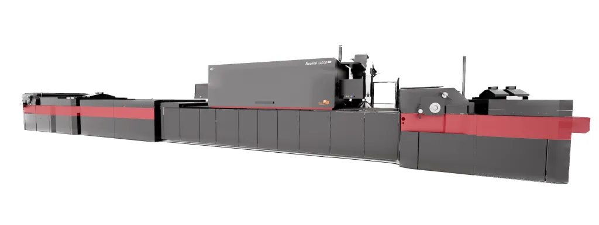
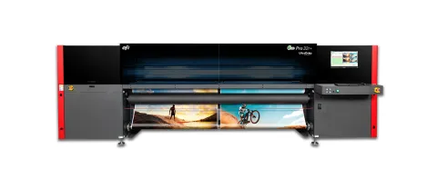
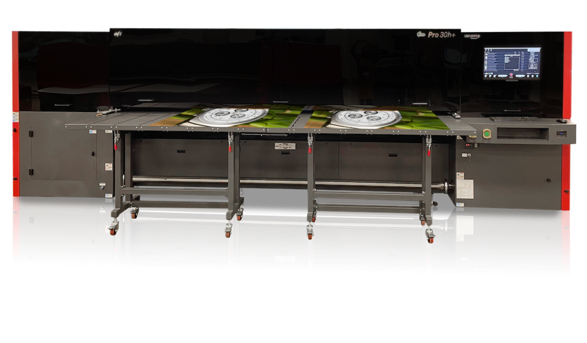

# LIDYA GRUP | EFI (ELECTRONICS FOR IMAGING) ÜRÜN BROŞÜRÜ

  

**Endüstriyel Süper Geniş Format, Ambalaj ve Oluklu Mukavva Dijital Baskı Teknolojileri**  
*Web: [www.lidyagrup.com.tr](https://www.lidyagrup.com.tr) | İletişim: 0542 352 72 99 | E-posta: yasin.albostanli@lidyagrup.com.tr*  
*Genel Merkez: Şerifali Mah. Şehit Sok. No: 6 Ümraniye / İstanbul*

---

## 1. EFI™ Nozomi 14000 LED / AQ / SD Serisi
> **"Ambalaj ve Oluklu Mukavvada Tek Geçişli (Single-Pass) Dijital Devrim"**

### Genel Bakış
EFI™ Nozomi serisi, oluklu mukavva, kutu ve ambalaj üreticileri için tasarlanmış dünyanın en gelişmiş endüstriyel tek geçişli dijital baskı platformudur. Ofset ve flekso kalitesini dijitalin sağladığı kalıpsız ve anlık kişiselleştirme gücüyle buluşturur.

### Öne Çıkan Özellikler
- **Ultra Yüksek Üretim Hızı:** Dakikada **75 lineer metreye** kadar hat hızı; saatte **10.000 m²** üretim kapasitesi.
- **Tek Geçiş Teknolojisi:** Malzeme makinenin altından tek bir kez geçerken tüm CMYK + Beyaz + Turuncu/Menekşe renk katmanları anında basılır ve LED UV ile kürlenir.
- **Geniş Malzeme Yelpazesi:** Mikro flütten çift dalga olukluya (E, B, C, EB flüt) kadar 0.8 mm'den 3 mm'ye kadar levhalar.
- **Gıdaya Uygun Mürekkep Seçenekleri (AQ Serisi):** Kokusuz, su bazlı ve gıda temas standartlarına uygun mürekkep formülasyonu.
- **Hatasız Otomatik Besleme ve İstifleme:** Sürekli yüksek hızlı vakumlu palet besleyici ve robotik istifleyici entegrasyonu.

### Teknik Özellik Tablosu
| Özellik | Değer / Açıklama |
| :--- | :--- |
| **Baskı Genişliği** | 1.40 metre (Nozomi 14000) / 1.70 metre (Nozomi 17000) |
| **Maksimum Hat Hızı** | 75 metre / dakika |
| **Maksimum Çözünürlük** | 720 x 720 dpi (Çok seviyeli gri tonlamalı damla boyutu) |
| **Mürekkep Teknolojisi** | EFI Yüksek Dayanımlı LED UV / Su Bazlı (AQ) Mürekkepler |
| **Renk Konfigürasyonu** | CMYK, CMYK+W, CMYK+OV, CMYK+W+OV |
| **Uygulama Alanları** | E-ticaret kutuları, POP/POS standlar, raf tipi ambalajlar (SRP) |

---

## 2. EFI™ Pro 32r+ Roll-to-Roll LED Baskı Sistemi
> **"3.2 Metre Rulodan Ruloya Üstün LED UV Verimliliği"**

### Genel Bakış
EFI™ Pro 32r+, açık hava reklamcılığı, araç giydirme, arkadan aydınlatmalı (backlit) tabelalar ve tekstil baskı uygulamaları için geliştirilmiş yüksek hızlı 3.2 m rulo UV LED baskı makinesidir.

### Öne Çıkan Özellikler
- **Yüksek Hız:** Saatte **256 m²**'ye kadar baskı kapasitesi.
- **UltraDrop™ 7 pL Teknolojisi:** 7 pikolitre değişken damla boyutu ile pürüzsüz ten tonları ve mikro keskinlikte yazılar.
- **Çift Taraflı Baskı (Day-Night / Backlit):** Entegre sensörlü kamera sistemi sayesinde arkadan aydınlatmalı afişlerde birebir ön-arka hizalama.
- **Dahili Entegre Kesici (Slitter):** Baskı devam ederken otomatik boyuna kenar kesimi yaparak zaman ve işçilikten tasarruf sağlar.
- **Düşük Enerji Tüketimi:** Soğuk LED kürleme ile ısıya duyarlı ince folyolarda deformasyonsuz baskı ve %50 daha az elektrik tüketimi.

### Teknik Özellik Tablosu
| Özellik | Değer / Açıklama |
| :--- | :--- |
| **Baskı Genişliği** | 3.20 metre (126 inç) |
| **Maksimum Üretim Hızı** | 256 m²/saat |
| **Baskı Çözünürlüğü** | 1200 dpi'a kadar gerçek çözünürlük |
| **Mürekkep Seti** | CMYK + İsteğe bağlı Çift Beyaz (White Ink) |
| **Medya Çeşitleri** | Vinil branda, folyo, mesh, duratrans, kanvas, duvar kağıdı |

---

## 3. EFI™ Pro 30h+ Hibrit LED UV Baskı Sistemi
> **"Hem Plaka (Flatbed) Hem Rulo (Roll-to-Roll) Tek Gövdede Hibrit Çözüm"**

### Genel Bakış
EFI™ Pro 30h+, hem sert levhalara (pleksi, foreks, fotoblok, alüminyum, ahşap) hem de rulo malzemelere geçiş yapabilen 3.2 metre genişliğinde endüstriyel hibrit baskı makinesidir.

### Öne Çıkan Özellikler
- **Gerçek Hibrit Esneklik:** Dakikalar içinde plaka baskı masasından rulo besleme moduna geçiş.
- **Üretim Hızı:** Saatte **235 m²**'ye varan yüksek verimlilik.
- **5.08 cm Malzeme Kalınlığı:** 5 cm'ye kadar olan kalın plakalara doğrudan baskı imkanı.
- **Çok Katmanlı Beyaz Baskı:** Renk-Beyaz-Renk (sandwich mode) baskı ile şeffaf pleksi ve camlarda mükemmel görünüm.
- **Entegre Vakum Masası:** Güçlü çok bölgeli vakum sistemi ile eğri veya ağır levhaları düzleştirerek hatasız besleme.

---

## 4. EFI™ VUTEk® Serisi (VUTEk 3r+, 5r+, Q3h/Q5h, D3r/D5r)
> **"Küresel Reklam Devlerinin Tercihi: Süper Geniş Format Endüstriyel Canavar"**

- **Baskı Genişlikleri:** 3.5 metre ve 5.0 metre süper geniş ebatlar.
- **Hızlar:** Saatte 400 m² ile 1.000 m² arasında kesintisiz 7/24 endüstriyel üretim.
- **Ağır Hizmet Şasisi:** Deformasyona dayanıklı yekpare döküm şasi yapısı ile uzun yıllar boyu milimetrik hassasiyet.
- **Otomatik Yıkama ve Bakım:** Operatör müdahalesini en aza indiren akıllı kafa temizleme sistemleri.

---
*Lidya Grup, EFI Türkiye distribütörü olarak anahtar teslim kurulum, profil yönetimi ve teknik destek sunmaktadır.*

