# LIDYA GRUP | KEUNDO DİJİTAL BASKI SİSTEMLERİ ÜRÜN BROŞÜRÜ

<div align="center" style="margin: 1.5rem 0 2rem;">
  
</div>

**Lidya Grup Resmi Distribütörlüğü Güvencesiyle Keundo Endüstriyel Dijital Baskı Çözümleri**  
*Web: [www.lidyagrup.com.tr/marka/keundo/?all=1](https://www.lidyagrup.com.tr/marka/keundo/?all=1) | Servis & Bilgi Hattı: 0542 352 72 99 | E-posta: yasin.albostanli@lidyagrup.com.tr*  
*Genel Merkez: Şerifali Mah. Şehit Sok. No: 6 Ümraniye / İstanbul*

---

## 📌 KEUNDO ÜRÜN GRUPLARI VE MODEL LİSTESİ (17 ÜRÜN)

Keundo, açık hava reklamcılığından mimari dekorasyona, promosyondan süper geniş format cephe giydirmeye kadar 4 ana kategoride toplam 17 güçlü model sunmaktadır:

```
KEUNDO ÜRÜN GRUPLARI
├── 1. ECO SOLVENT BASKI SİSTEMLERİ (4 Ürün)
│   ├── Keundo K1-16S (1.6m Roll-to-Roll, Tek Epson i3200-E1 Kafa)
│   ├── Keundo K2-18S (1.8m Roll-to-Roll, Çift Epson i3200-E1 Kafa)
│   ├── Keundo K4-18S (1.8m Roll-to-Roll, 4 Epson Kafa & 8 Renk Desteği)
│   └── Keundo K4-3204S (3.2m Süper Geniş Format, 4 Kafa, Ağır Hizmet Tipi)
│
├── 2. FLATBED UV DİGİTAL BASKI SİSTEMLERİ (3 Ürün)
│   ├── Keundo K6090UV (600 x 900 mm Kompakt / Silindirik Şişe Aparatlı UV Flatbed)
│   ├── Keundo SQ-2513 (2500 x 1300 mm Endüstriyel UV Flatbed - Ricoh Gen6)
│   └── Keundo SQ-3220 (3200 x 2000 mm Devasa Plaka UV Flatbed - 5x Ricoh Gen6)
│
├── 3. HYBRİT UV DİGİTAL BASKI SİSTEMLERİ (4 Ürün)
│   ├── Keundo Hybrid UV SQ-1800H (1.8m Konveyörlü Rulo + Plaka Hibrit - Ricoh Gen6)
│   ├── Keundo Hybrid UV SQ1806 Plus (1.8m Konveyörlü Hibrit - 6x Epson Kafa)
│   ├── Keundo Hybrid UV SQ2500H (2.5m Konveyörlü Endüstriyel Hibrit - Ricoh Gen6)
│   └── Keundo Hybrid UV SQ3200H (3.2m Süper Geniş Konveyörlü Hibrit - Ricoh Gen6)
│
└── 4. ROLL TO ROLL UV DİGİTAL BASKI SİSTEMLERİ (6 Ürün)
    ├── Keundo Q1-16UV (1.6m Kompakt Roll-to-Roll LED-UV)
    ├── Keundo Q2-18UV (1.8m Çift Kafalı LED-UV, Beyaz + Renk Eşzamanlı)
    ├── Keundo Q4-18UV (1.8m 4 Kafalı Yüksek Hızlı LED-UV + Vernik)
    ├── Keundo Q4-32UV (3.2m Geniş Format LED-UV, 4x Epson i3200-U1)
    ├── Keundo Roll2Roll UV M3200 (3.2m Endüstriyel Rulo UV Pres - 5x Ricoh Gen6)
    └── Keundo Roll2Roll UV M5000 (5.0m Devasa Rulo UV Pres - 5x Ricoh Gen6)
```

---

# BÖLÜM 1: ECO SOLVENT BASKI SİSTEMLERİ

Açık hava reklamcılığı, araç giydirme, folyo etiket ve tabela uygulamaları için kanıtlanmış dış mekan dayanımı ve canlı renkler.

---

### 1. Keundo K1-16S Eco Solvent Baskı Makinesi
> **"1.6 Metre Genişlikte Ekonomik, Kararlı ve Yüksek Çözünürlüklü Rulo Üretimi"**

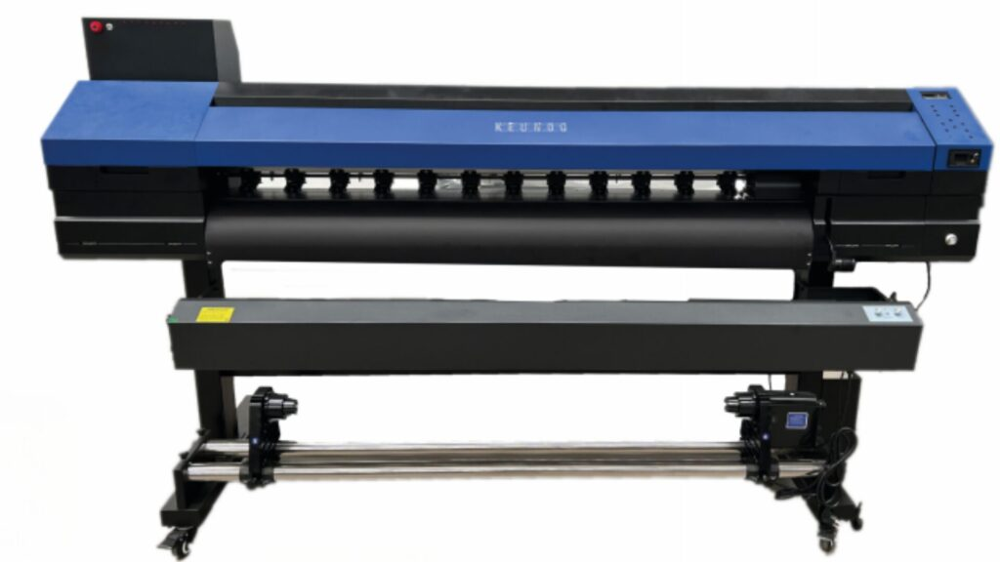

#### Genel Bakış
Keundo K1-16S, açık hava reklam atölyeleri ve butik tabelacılar için tasarlanmış 1.6 metre genişliğinde ekonomik roll-to-roll eko-solvent baskı makinesidir. Tekli Epson i3200-E1 kafa mimarisi ile düşük maliyet ve yüksek netlik sunar.

- **Baskı Genişliği:** 1600 mm (1.6 metre).
- **Baskı Kafası:** 1 adet Epson i3200-E1 piezo kafa.
- **Çözünürlük:** 3200 dpi'a varan mikro damla hassasiyeti.
- **Uygulamalar:** Folyo, vinil branda, canvas tablo, one way vision (delikli folyo), poster kağıdı.
- **Öne Çıkan Özellik:** Otomatik kafa temizleme ve nemlendirme istasyonu ile kafa tıkanmasını önleyen stabil yapı.

---

### 2. Keundo K2-18S Profesyonel Eco Solvent Baskı Makinesi
> **"1.8 Metre Genişlik ve Çift Kafa Gücüyle Yüksek Hızlı Reklam Üretimi"**

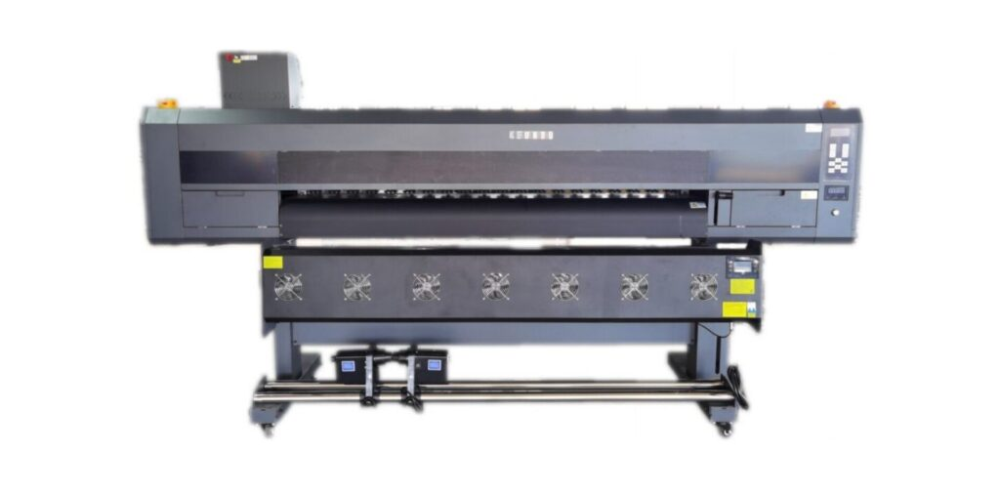

#### Genel Bakış
Keundo K2-18S, yoğun sipariş temposuna sahip reklamcılar için çift Epson i3200-E1 kafa ile donatılmış, 1.8 metre genişliğinde sınıfının en çok tercih edilen profesyonel eko-solvent çözümüdür.

- **Baskı Genişliği:** 1800 mm (1.8 metre).
- **Kafa Konfigürasyonu:** Çift (Dual) Epson i3200-E1 kafa.
- **Hız:** Saatte 45 - 65 m² üretim verimliliği.
- **Isıtma Sistemi:** Ön, orta ve arka olmak üzere 3 kademeli akıllı dijital ısıtma tablası.
- **Dayanım:** Güneş ışığı, UV ışınları ve yağmura karşı 3 yıla varan solmazlık standardı.

---

### 3. Keundo K4-18S Endüstriyel Eco Solvent Baskı Sistemi
> **"4 Baskı Kafası, 8 Renk Desteği ve Seri Üretim Canavarı"**

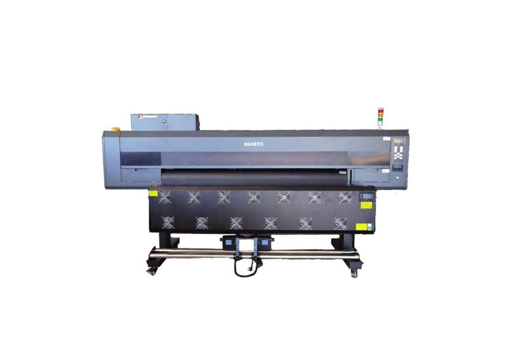

#### Genel Bakış
Keundo K4-18S; 4 adet bağımsız baskı kafası ve 8 renk (CMYK + Lc + Lm + Or + Gr) renk gamutu desteği ile fotoğrafik renk geçişleri ve yüksek hız gerektiren endüstriyel tabela üreticileri için tasarlanmıştır.

- **Baskı Eni:** 1800 mm.
- **Kafa Sayısı:** 4 adet Epson i3200 endüstriyel kafa.
- **Renk Seçenekleri:** 4 renk çift CMYK veya 8 renk genişletilmiş renk uzayı.
- **Tansiyon Kontrolü:** Ağır rulo malzemeleri (50 kg+) kırışmadan besleyen çift motorlu otomatik sarma ünitesi.

---

### 4. Keundo K4-3204S Süper Geniş Eco Solvent Baskı Makinesi
> **"3.2 Metre Süper Geniş Format, 4 Kafa ve THK Sessiz Lineer Ray Teknolojisi"**

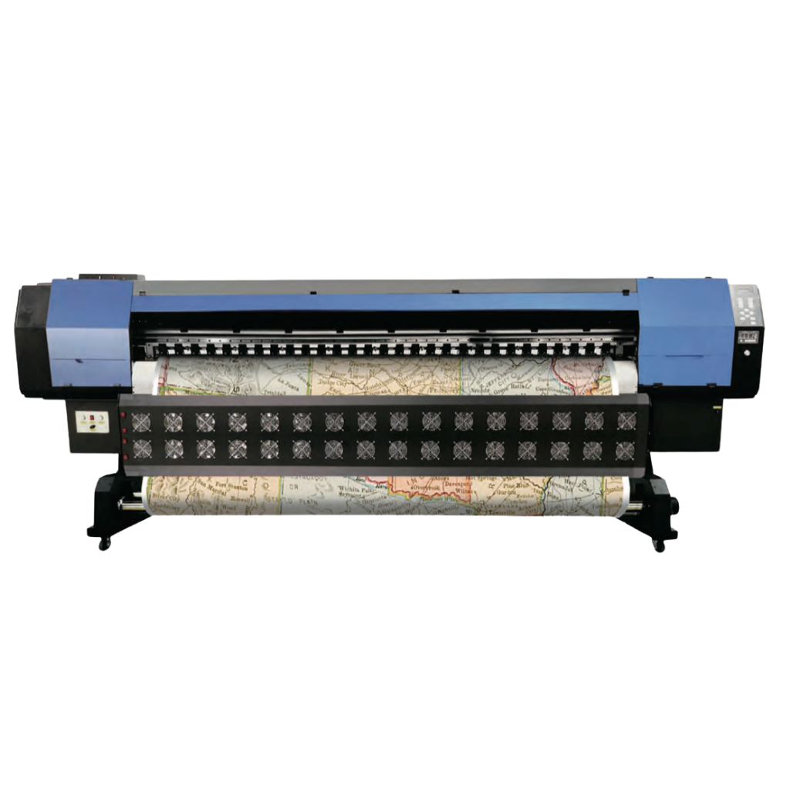

#### Genel Bakış
Keundo K4-3204S, billboard, bina cephe giydirme afişleri ve devasa vinil brandaları tek parça dikişsiz basmak için üretilmiş 3.2 metre genişliğinde endüstriyel eko-solvent platformudur.

- **Baskı Genişliği:** 3200 mm (3.2 metre).
- **Kafa Mimarisi:** 4 adet yüksek frekanslı piezo kafa.
- **Gövde:** Japon THK yüksek hassasiyetli sessiz lineer ray ve ağır şase.
- **Mürekkep Besleme:** 3 litrelik büyük tanklı kesintisiz dökme mürekkep sistemi ile düşük sayfa başı maliyet.

---

# BÖLÜM 2: FLATBED UV DİGİTAL BASKI SİSTEMLERİ

Cam, ahşap, metal, akrilik (pleksi), dekota, seramik ve sert endüstriyel levhalara doğrudan fotoğraf kalitesinde kalıcı baskı.

---

### 5. Keundo K6090UV Kompakt & Silindirik Flatbed UV
> **"600 x 900 mm Alanda 3D Dokulu Kabartma ve 360° Şişe/Termos Aparatı"**

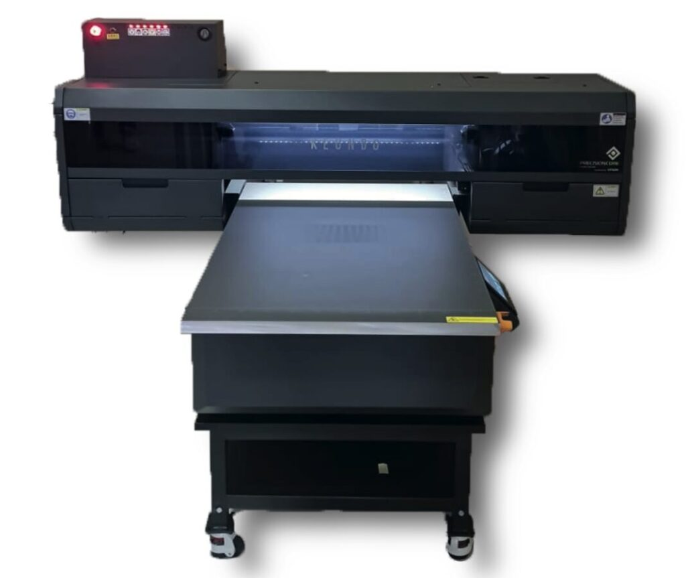

#### Genel Bakış
K6090UV, promosyon ürünleri, ödül plaketleri, telefon kılıfları, hediyelik eşyalar ve silindirik cisimler üzerine baskı yapmak için tasarlanmış yüksek hassasiyetli masaüstü/orta boy UV flatbed yazıcıdır.

- **Baskı Alanı:** 600 x 900 mm tabla ebadı.
- **Baskı Yüksekliği:** 150 mm'ye kadar kalın objeler.
- **Silindirik Döner Aparat:** Şişe, termos, kupa ve mum gibi yuvarlak cisimlere 360 derece eksiz baskı.
- **Mürekkep Sistemi:** CMYK + Beyaz + Vernik (Gloss Varnish) ile 3D kabartmalı dokular ve Braille alfabesi.

---

### 6. Keundo Flatbed UV SQ2513
> **"2500 x 1300 mm Standart Plaka Ebadı, 2400 dpi ve Ricoh Gen6 Endüstriyel Güç"**

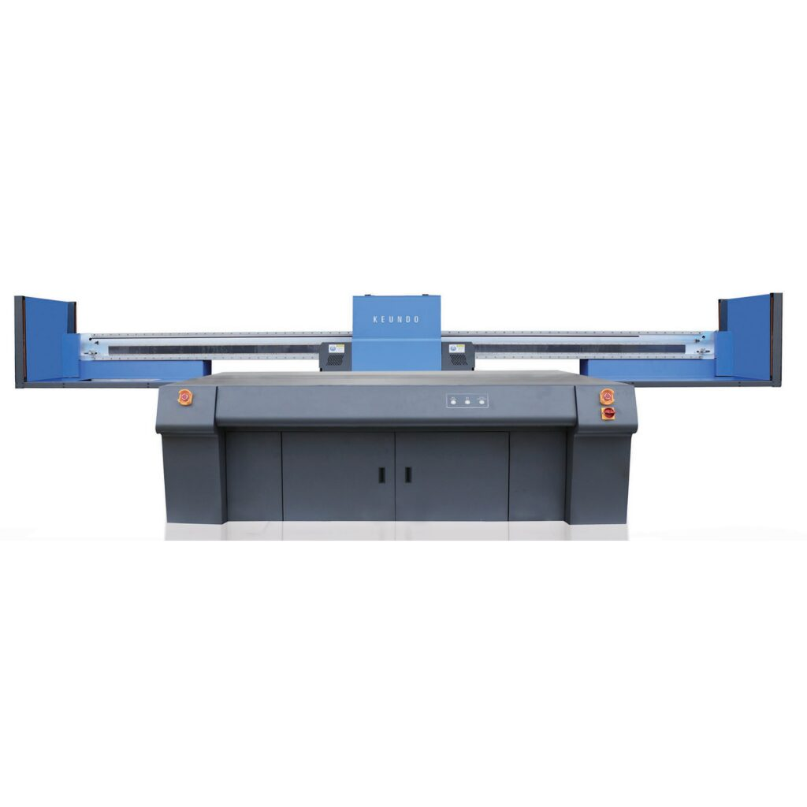

#### Genel Bakış
SQ2513; tabela, mobilya, cam dekorasyon ve mimari panel üreticilerinin en çok tercih ettiği 2.5 x 1.3 metre standart endüstriyel plaka baskı makinesidir.

- **Baskı Alanı:** 2500 x 1300 mm (Standart levha formatı).
- **Baskı Kafası:** Ricoh Gen5 veya Ricoh Gen6 endüstriyel piezo kafalar.
- **Çözünürlük:** 2400 dpi maksimum baskı çözünürlüğü.
- **Vakum Masası:** Bağımsız bölgeli güçlü vakum emişi ile küçük ve büyük parçaları tek tuşla sabitleme.
- **Hava Yastığı Fonksiyonu:** Ağır cam veya ahşap plakaları masada parmak ucuyla kaydırma kolaylığı.

---

### 7. Keundo Flatbed UV SQ-3220
> **"3200 x 2000 mm Devasa Plaka Alanı ve 5 Adet Ricoh Gen6 Kafa"**

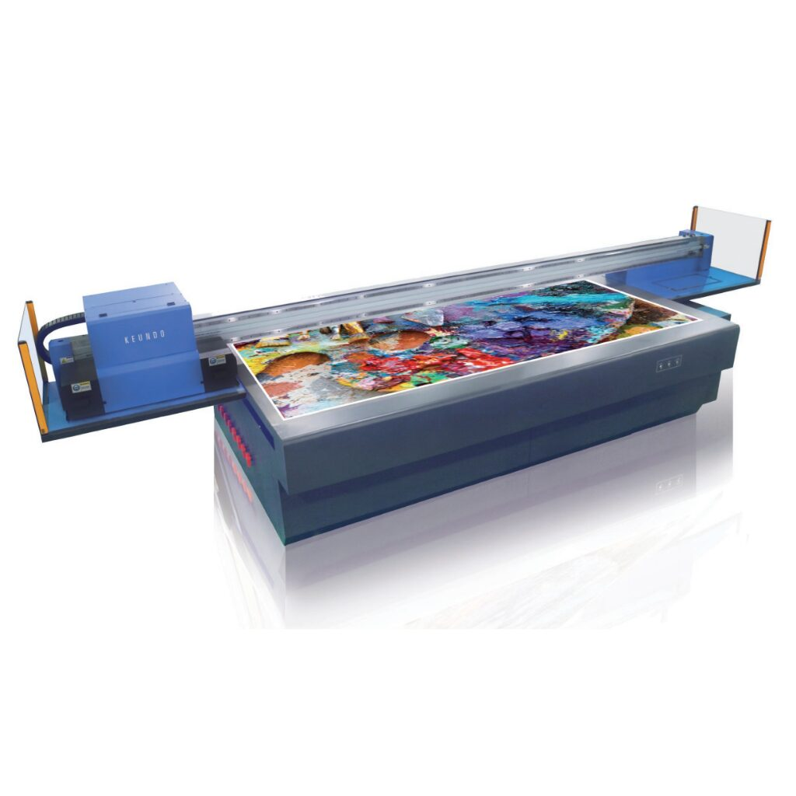

#### Genel Bakış
SQ-3220; 205x305 cm gibi en büyük endüstriyel pleksi, MDF, cam ve kompozit levhaları kesmeden tek seferde basabilen süper geniş düz yataklı UV baskı sistemidir.

- **Baskı Alanı:** 3200 x 2000 mm kesintisiz düz masa.
- **Kafa Konfigürasyonu:** 5 adet Ricoh Gen6 kafa (W + CMYK + V).
- **Hız:** Saatte 70 m²'ye varan üretim kapasitesi.
- **Kürleme:** Su soğutmalı çift LED UV kürleme lambaları.

---

# BÖLÜM 3: HYBRİT UV DİGİTAL BASKI SİSTEMLERİ

Vakumlu konveyör taşıma bandı sayesinde hem rulo malzemeleri (branda, folyo, kumaş) hem de sert plakaları (foreks, dekota, karton) tek bir gövdede basma esnekliği.

---

### 8. Keundo Hybrid UV SQ-1800H
> **"1.8 Metre Konveyörlü Rulo + Plaka Hibrit UV ve Ricoh Gen6 Teknolojisi"**

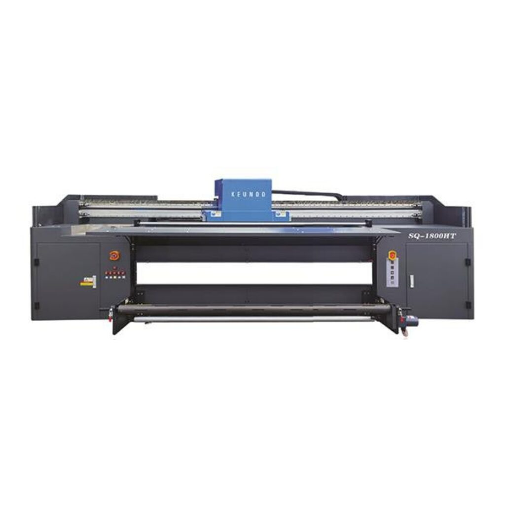

- **Baskı Genişliği:** 1800 mm konveyör bant.
- **Kafa Teknolojisi:** 5 adet Ricoh Gen6 kafa.
- **Esneklik:** İhtiyaç anında açılan uzatma tablaları ile sert plakalar, katlandığında rulo branda üretimi.
- **Medya Kalınlığı:** 50 mm kalınlığa kadar her türlü rijit ve esnek malzeme.

---

### 9. Keundo Hybrid UV SQ1806 Plus
> **"1.8 Metre Genişlik ve 6 Adet Epson Kafa İle Fotoğrafik Hibrit UV Kalitesi"**

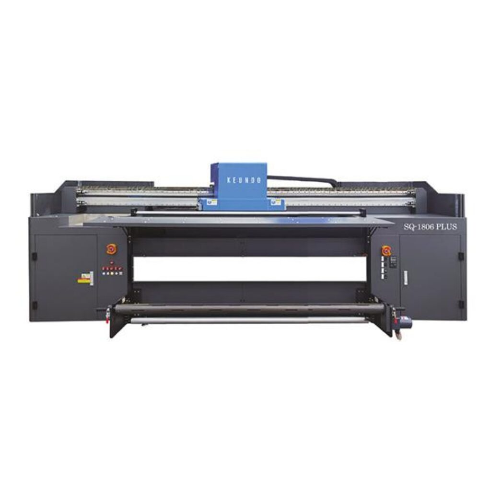

- **Baskı Genişliği:** 1800 mm hibrit konveyörlü besleme.
- **Kafa Mimarisi:** 6 adet Epson baskı kafası ile ultra yüksek detay ve canlı renk doygunluğu.
- **Kürleme:** Enerji tasarruflu soğuk LED UV sistemi.
- **Uygulamalar:** Işıklı kumaş panolar, arkadan aydınlatmalı pleksi, ambalaj numuneleri.

---

### 10. Keundo Hybrid UV SQ2500H
> **"2.5 Metre Endüstriyel Konveyörlü Hibrit UV ve Kesintisiz Üretim"**

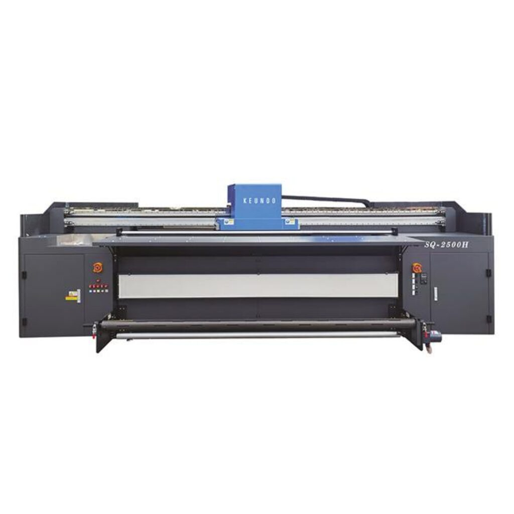

- **Baskı Genişliği:** 2500 mm (2.5 metre) vakumlu konveyör taşıyıcı bant.
- **Kafa:** 5 adet Ricoh Gen6 endüstriyel kafa.
- **Özellik:** Ağır plakaları ve geniş vinil ruloları kaydırmadan taşıyan otomatik tansiyon sistemi.

---

### 11. Keundo Hybrid UV SQ3200H
> **"3.2 Metre Süper Geniş Hibrit UV Sisteminde Maksimum Çok Yönlülük"**

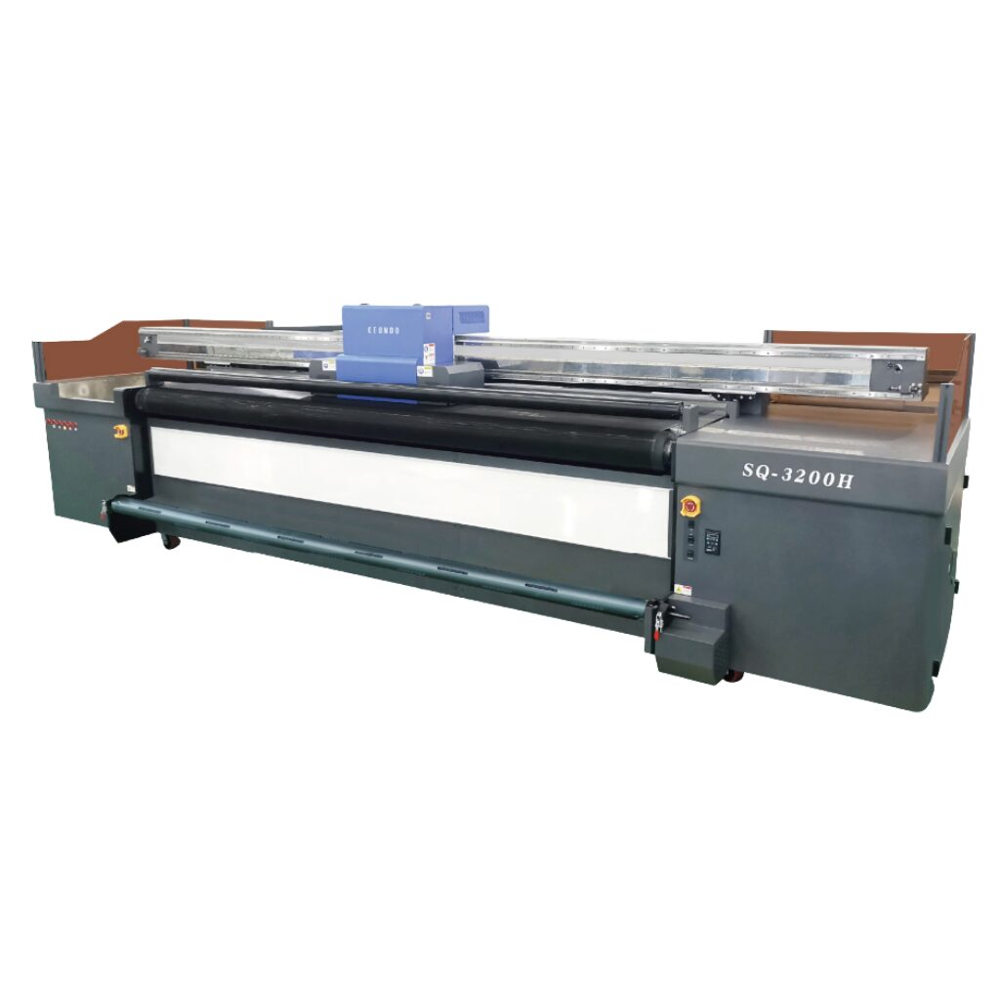

- **Baskı Genişliği:** 3200 mm (3.2 metre).
- **Kafa Donanımı:** 5 adet Ricoh Gen6 kafa.
- **Çoklu Malzeme:** 3.2 m rulo kumaş/vinil ile standart 2x3 m sert levhaları tek bir yatırımda birleştirir.

---

# BÖLÜM 4: ROLL TO ROLL UV DİGİTAL BASKI SİSTEMLERİ

Anında kuruyan, çevre dostu, kokusuz ve 5 katmanlı baskı desteği sunan rulo LED-UV üretim presleri.

---

### 12. Keundo Q1-16UV Kompakt Roll-to-Roll LED-UV
> **"1.6 Metre Genişlikte LED-UV Kürleme, CMYK ve Beyaz Baskı Desteği"**

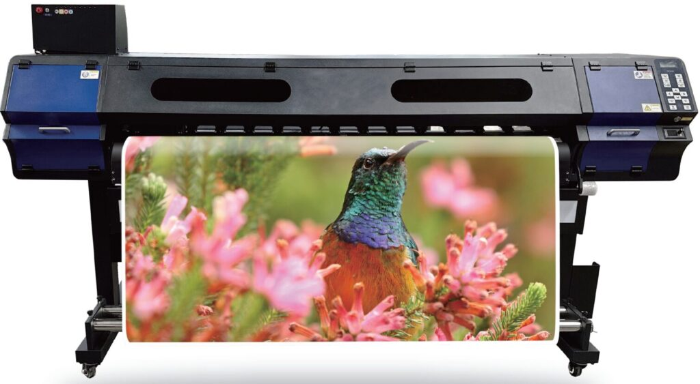

- **Baskı Eni:** 1600 mm (1.6 metre).
- **Teknoloji:** Soğuk LED-UV kurutma ile ısıya duyarlı ince folyo ve kumaşlarda sıfır deformasyon.
- **Renkler:** CMYK ve W+CMYK (Beyaz destekli şeffaf folyo baskısı).

---

### 13. Keundo Q2-18UV Çift Kafalı Roll-to-Roll LED-UV
> **"1.8 Metre Genişlik, Çift Kafa ve Eşzamanlı Renk + Beyaz Üretimi"**

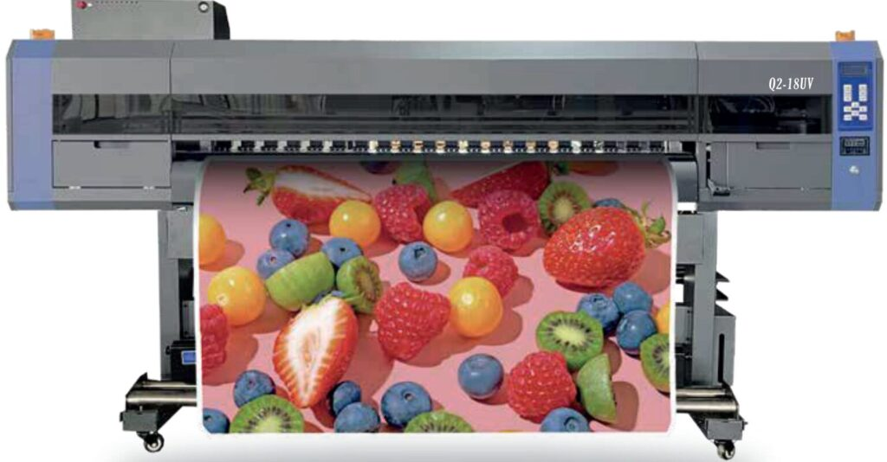

- **Baskı Eni:** 1800 mm.
- **Kafalar:** Çift kafa (Dual i1600-U1) mimarisi.
- **Uygulama:** Şeffaf vitrin cam filmleri, çift taraflı ışıklı görseller, arkadan aydınlatmalı afişler.

---

### 14. Keundo Q4-18UV Profesyonel 4 Kafalı LED-UV
> **"1.8 Metre Genişlik, 4 Kafa, Vernik ve Çok Katmanlı Kabartma Baskı"**

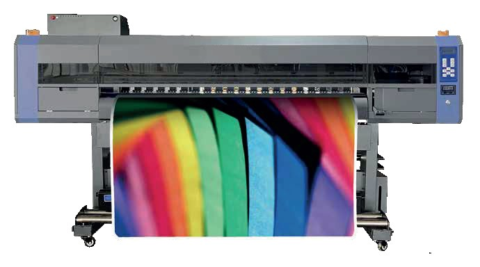

- **Kafa Sayısı:** 4 adet yüksek hızlı endüstriyel kafa.
- **Katman Yeteneği:** Renkli + Beyaz + Renkli veya Renkli + Beyaz + Vernik modları.
- **Hız:** Seri dış mekan rulo üretimlerinde yüksek verimlilik.

---

### 15. Keundo Q4-32UV Geniş Format LED-UV Pres
> **"3.2 Metre Genişlik, 4 Adet Epson i3200-U1 Kafa ve Fotoğrafik Kalite"**

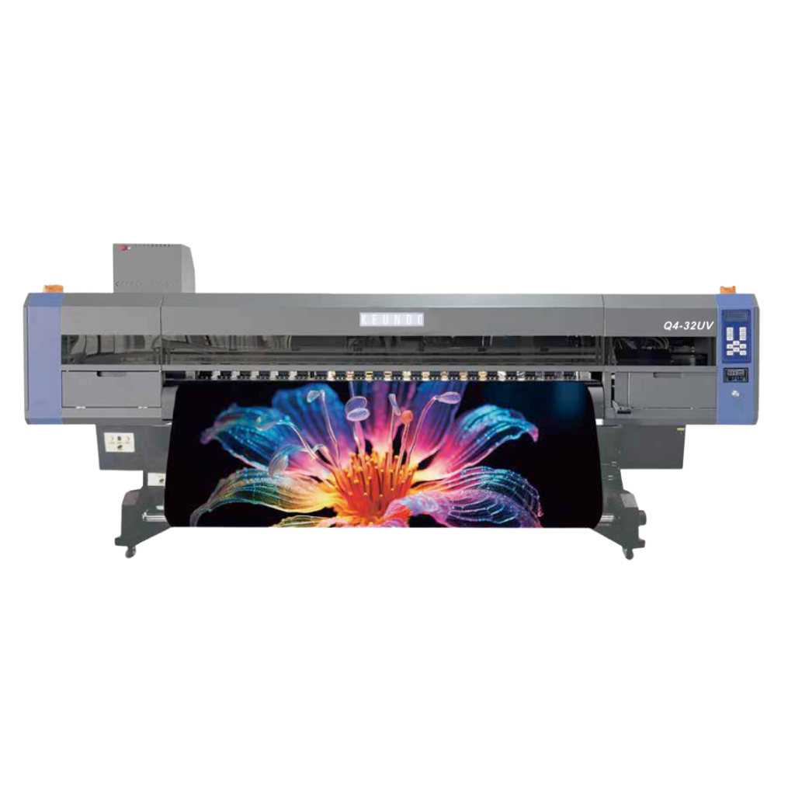

- **Baskı Genişliği:** 3200 mm (3.2 metre).
- **Kafa:** 4 adet Epson i3200-U1 UV kafa.
- **Kullanım:** Işıklı tekstil kumaşları (lightbox), gergi tavanlar, duvar kağıtları ve mega afişler.

---

### 16. Keundo Roll2Roll UV M3200 Endüstriyel Pres
> **"3.2 Metre Ağır Hizmet Tipi Rulo UV Baskı ve 5 Adet Ricoh Gen6 Kafa"**

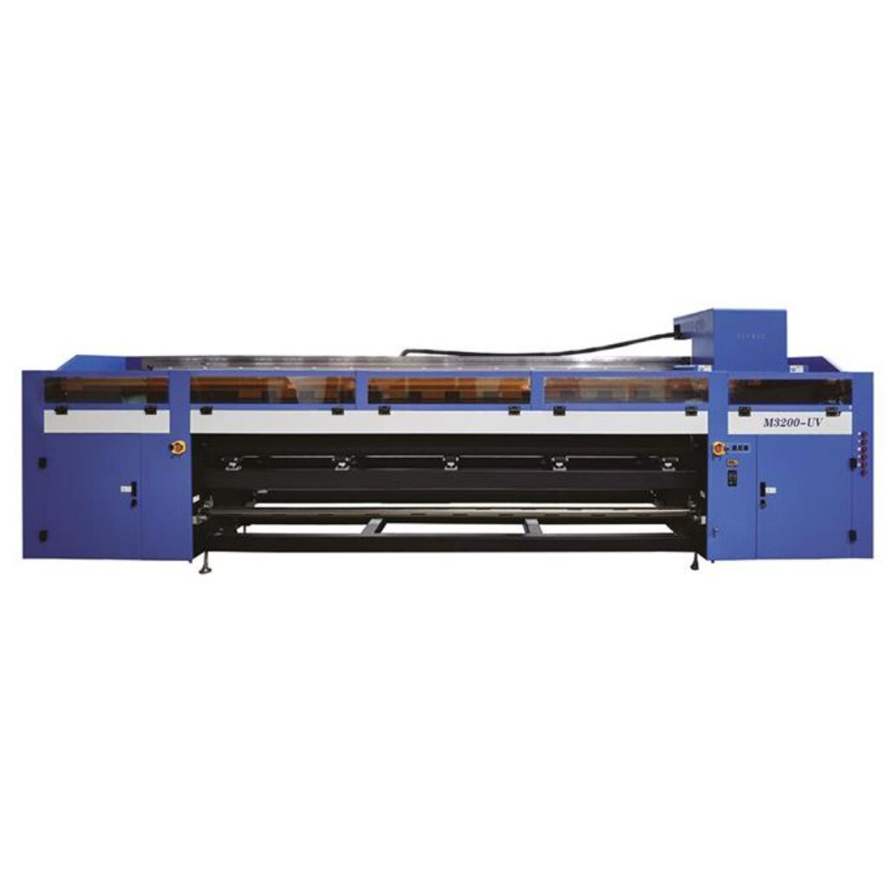

- **Baskı Genişliği:** 3200 mm.
- **Kafalar:** 5 adet Ricoh Gen6 endüstriyel kafa.
- **Şase:** 24 saat kesintisiz çalışmaya uygun endüstriyel çelik gövde ve ağır rulo tansiyon kontrolü.

---

### 17. Keundo Roll2Roll UV M5000 Süper Geniş Format Pres
> **"5.0 Metre Devasa Rulo Baskı Eni ve 5 Adet Ricoh Gen6 Kafa"**

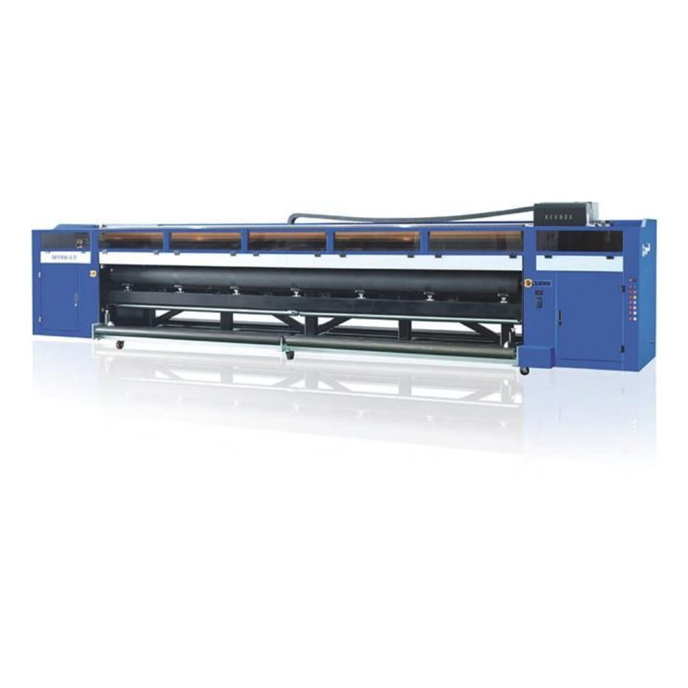

- **Baskı Genişliği:** 5000 mm (5.0 metre).
- **Kafa Donanımı:** 5 adet Ricoh Gen6 endüstriyel piezo kafa.
- **Uygulamalar:** Havalimanı panoları, bina cephe kaplamaları, dikişsiz mega vinil ve tekstil reklamları.

---

### 🏢 Lidya Grup Satış Sonrası ve Teknik Hizmet Güvencesi
- **Resmi Distribütörlük:** Lidya Grup uzman teknik servis ekipleri ile kurulum, kalibrasyon ve operatör eğitimi.
- **Orijinal Boya & Parça:** Orijinal Keundo eko-solvent ve UV boyalar, yedek kafalar ve filtreler garantili tedarik edilir.
- **İletişim:** 0542 352 72 99 | yasin.albostanli@lidyagrup.com.tr
