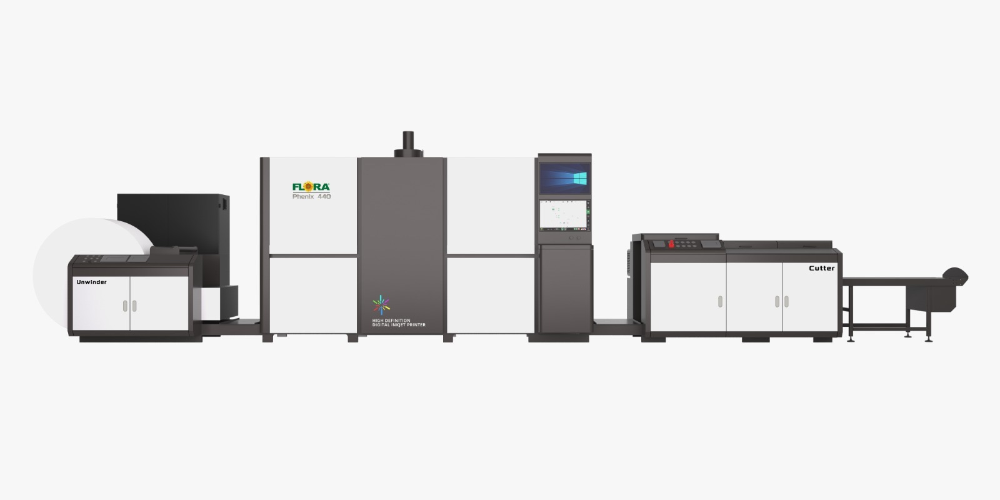
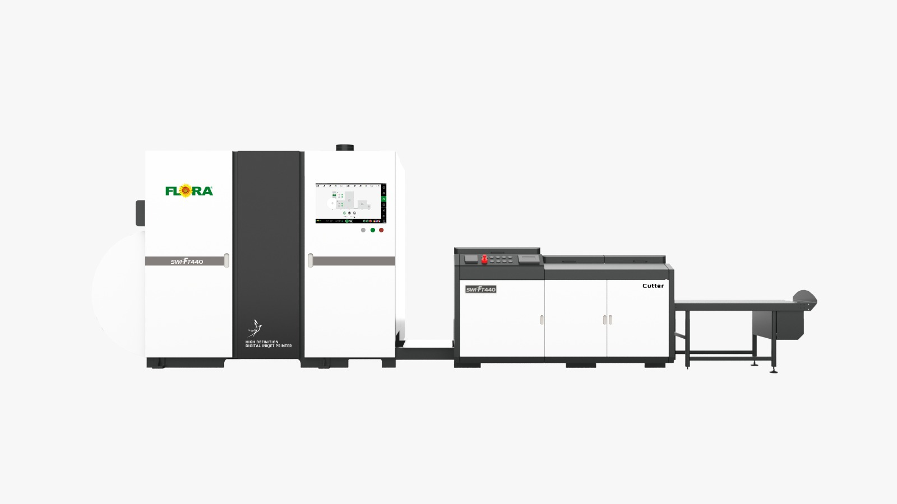
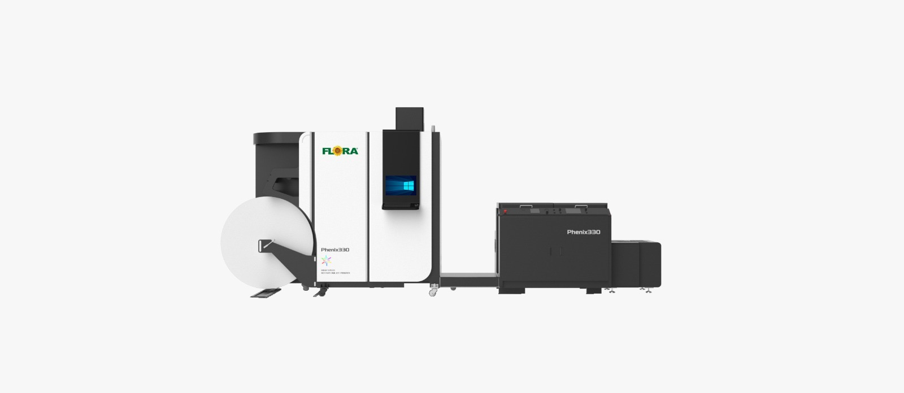
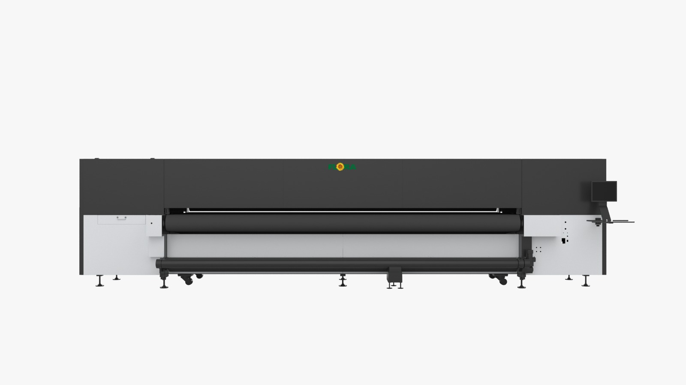
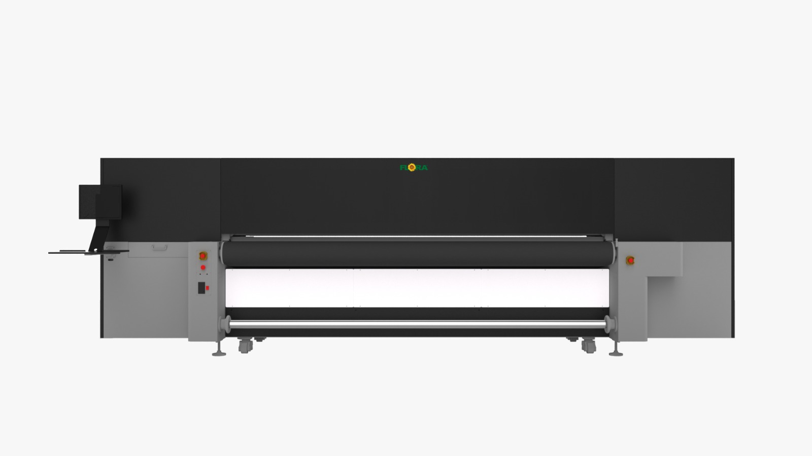
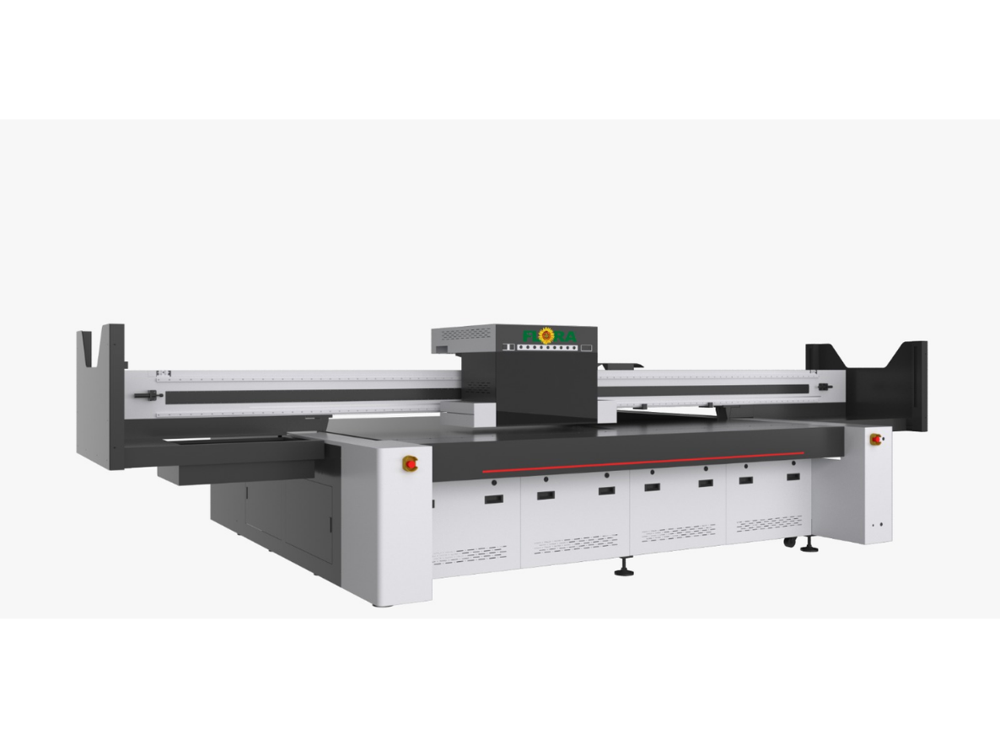
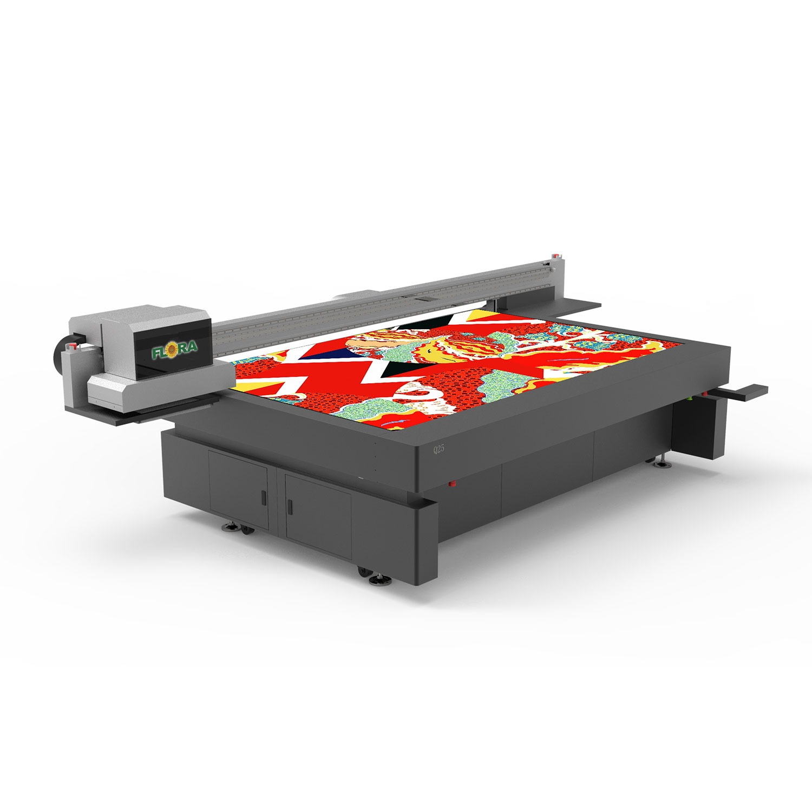

# LIDYA GRUP | FLORA DİJİTAL BASKI SİSTEMLERİ ÜRÜN BROŞÜRÜ

<div align="center" style="margin: 1.5rem 0 2rem;">
  
</div>

**Lidya Grup Resmi Distribütörlüğü Güvencesiyle Flora Endüstriyel Baskı Çözümleri**  
*Web: [www.lidyagrup.com.tr/marka/flora/?all=1](https://www.lidyagrup.com.tr/marka/flora/?all=1) | Servis & Bilgi Hattı: 0542 352 72 99 | E-posta: yasin.albostanli@lidyagrup.com.tr*  
*Genel Merkez: Şerifali Mah. Şehit Sok. No: 6 Ümraniye / İstanbul*

---

## 📌 FLORA ÜRÜN GRUPLARI

Flora, yüksek hacimli kitap, doküman ve ambalaj üretimi için geliştirilmiş **Bobin (Sürekli Beslemeli Endüstriyel Inkjet)** serisi ile açık hava reklamcılığı, tabela ve endüstriyel yüzeyler için tasarlanmış **Geniş Format UV Baskı** sistemleri olmak üzere 2 ana kategoride toplam 7 güçlü model sunmaktadır.

```
FLORA ÜRÜN GRUPLARI
├── 1. BOBİN GRUBU (Sürekli Beslemeli Endüstriyel Inkjet Sistemleri)
│   ├── Flora Phenix 440 / 440C (Renkli / Çift Taraflı - 100 m/dk)
│   ├── Flora Swift 440 (Yüksek Hızlı S/B Kitap & Veri - 120 m/dk)
│   └── Phenix 330 / 330C (Kompakt Bobin Inkjet - 100 m/dk)
│
└── 2. GENİŞ FORMAT UV BASKI GRUBU (Flatbed & Hibrit UV Sistemleri)
    ├── Flora XTRA 5000H (5.0 Metre Ultra Geniş Format UV Hibrit - 440 m²/saat)
    ├── Flora XTRA 3300H (3.3 Metre Endüstriyel UV Hibrit - 136 m²/saat)
    ├── Flora XTRA 3220LED (3.2 x 2.0 Metre Endüstriyel UV Flatbed - 219 m²/saat)
    └── Flora Q25 (2.54 x 1.30 Metre Hassas UV Flatbed + Vernik - 155 m²/saat)
```

---

# BÖLÜM 1: BOBİN (SÜREKLİ BESLEMELİ ENDÜSTRİYEL INKJET SİSTEMLERİ)

---

### 1.1 Flora Phenix 440 / 440C Endüstriyel Inkjet Baskı Sistemi
> **"100 m/dk Baskı Hızı, 1200 dpi Çözünürlük ve Çift Taraflı Yüksek Hacimli Üretim Gücü"**



#### Genel Bakış
Flora Phenix 440 / 440C, yüksek hacimli üretim ihtiyaçları için geliştirilmiş endüstriyel bobin inkjet baskı sistemidir. Sürekli beslemeli (roll-to-roll) yapısı sayesinde özellikle yayıncılık, kitap basımı, transaksiyonel fatura/hesap özeti ve yüksek adetli ticari doküman baskı süreçlerinde maksimum verimlilik ve minimum birim sayfa maliyeti sunar.

Micro piezoelectric grayscale baskı kafası teknolojisi ile 1200 dpi yüksek çözünürlük ve net detaylar sağlarken, su bazlı çevre dostu pigment mürekkep formülü ile ışığa ve neme dayanıklı solmayan baskı kalitesi elde edilir. Dakikada 100 metreye kadar baskı hızı ve 673 A4 sayfa/dakika üretim kapasitesi ile büyük hacimli yayın işlerinde kesintisiz bir üretim canavarıdır.

#### Öne Çıkan Özellikler
- **100 m/dk Yüksek Baskı Hızı:** 1-bit modunda 100 m/dk, 2-bit modunda 50 m/dk hızla kesintisiz bobin işleme.
- **673 A4 Sayfa/Dakika Üretim Kapasitesi:** Vardiya başına yüz binlerce sayfalık rekor tiraj tamamlama.
- **1200 x 1200 dpi Grayscale Çözünürlük:** Değişken damla boyutlu kafa mimarisi ile jilet gibi keskin metinler ve pürüzsüz degrade geçişler.
- **Çift Taraflı (Duplex) Senkronize Baskı:** Tek geçişte kağıdın her iki yüzüne birden mikron seviyesinde kusursuz kayıtla baskı.
- **Geniş Medya Yelpazesi (45 - 157 gsm):** Standart 1. hamur ofset kağıdı, kitap kağıdı ve hafif gramajlı kuşe/özel yayın kağıtları.
- **Su Bazlı Pigment Mürekkep:** Çevre dostu, koku yapmayan, çocuk kitapları ve kurumsal evraklar için güvenli sertifikalı boya sistemi.
- **Mono ve Renkli Seçenekleri:** Phenix 440 (Yüksek hacimli Siyah/Beyaz yayıncılık) ve Phenix 440C (Full Renkli CMYK).

#### Kapsamlı Teknik Özellikler Tablosu
| Özellik | Değer / Açıklama |
| :--- | :--- |
| **Model Kodu** | Flora Phenix 440 (Mono) / Phenix 440C (Renkli CMYK) |
| **Ürün Grubu** | Endüstriyel Bobin Inkjet Baskı Sistemi |
| **Maksimum Baskı Hızı** | 100 m/dk (1-bit) / 50 m/dk (2-bit) |
| **Üretim Kapasitesi** | 673 A4 sayfa / dakika |
| **Baskı Çözünürlüğü** | 1200 x 600 dpi / 1200 x 1200 dpi |
| **Baskı Kafası** | Micro Piezoelectric Grayscale Baskı Kafaları |
| **Maksimum Baskı Genişliği** | 436 mm |
| **Maksimum Medya Genişliği** | 460 mm |
| **Medya Gramaj Aralığı** | 45 – 157 gsm (Ofset, kitap, 1. hamur) |
| **Mürekkep Cinsi** | Su bazlı çevre dostu pigment mürekkep |
| **Baskı Modu** | Çift Taraflı (Duplex) Senkronize Baskı |
| **Besleme Sistemi** | Roll-to-Roll / Roll-to-Sheet (Otomatik Tansiyonlu) |
| **Fiziksel Ebatlar** | 9650 x 2350 x 2300 mm |
| **Toplam Ağırlık** | 8000 kg (8 Ton Endüstriyel Gövde) |
| **Uygulama Alanları** | Kitap ve yayıncılık, doğrudan posta (fatura/ekstre), ticari raporlar, kurumsal baskı, VDP değişken veri. |

---

### 1.2 Flora Swift 440 Endüstriyel Inkjet Baskı Sistemi
> **"120 m/dk Baskı Hızı, 808 A4/dk Kapasiteyle S/B Kitap & Veri Üretim Canavarı"**



#### Genel Bakış
Flora Swift 440, yüksek hacimli ve kesintisiz üretim gerektiren baskı operasyonları için geliştirilmiş endüstriyel inkjet bobin baskı sistemidir. Sürekli beslemeli rulo yapısı ile kitap, yayıncılık, sınav evrakları ve kurumsal doküman üretiminde maksimum hız ve en düşük sayfa başı birim maliyeti sunar.

Micro piezoelectric grayscale baskı kafası teknolojisi ile 1200 dpi çözünürlükte jilet gibi net metinler sunarken, su bazlı pigment siyah mürekkebi ile solmayan derin siyahlar üretir. Dakikada 120 metreye kadar baskı hızı ve 808 A4 sayfa/dakika üretim kapasitesi ile matbaa ve yayıncıların en yüksek tirajlı işlerini rekor sürede tamamlar.

#### Öne Çıkan Özellikler
- **120 m/dk Maksimum Hız:** Dakikada 120 metre kesintisiz siyah-beyaz bobin işleme.
- **808 A4 Sayfa/Dakika:** Seri kitap, sınav fasikülü ve sözleşme üretiminde rakipsiz kapasite.
- **1200 x 1200 dpi Yüksek Çözünürlük:** Değişken damla boyutlu kafa yapısı ile en küçük puntolarda dahi kristal netliğinde metinler ve barkodlar.
- **Çift Taraflı (Duplex) Senkronize Baskı:** Tek geçişte kağıdın her iki yüzüne birden mikron seviyesinde kusursuz kayıtla baskı.
- **Geniş Kağıt Gramaj Yelpazesi (45 - 157 gsm):** Standart 1. hamur ofset kağıdı, kitap kağıdı ve hafif gramajlı kuşe/özel yayın kağıtları.
- **Su Bazlı Pigment Siyah Mürekkep:** Çevre dostu, koku yapmayan, ışığa ve neme dayanıklı formül.
- **Tonere Kıyasla Olağanüstü Kârlılık:** Sayfa başı maliyetleri geleneksel lazer/toner sistemlerine kıyasla çok daha düşüktür.

#### Kapsamlı Teknik Özellikler Tablosu
| Özellik | Değer / Açıklama |
| :--- | :--- |
| **Model Kodu** | Flora Swift 440 |
| **Ürün Grubu** | Endüstriyel Bobin Inkjet Baskı Sistemi (Mono) |
| **Maksimum Baskı Hızı** | 120 m/dk (1200 x 600 dpi modunda) |
| **Hassas Mod Hızı** | 60 m/dk (1200 x 1200 dpi modunda) |
| **Üretim Kapasitesi** | 808 A4 sayfa / dakika |
| **Baskı Çözünürlüğü** | 1200 x 600 dpi / 1200 x 1200 dpi |
| **Baskı Kafası** | Micro Piezoelectric Grayscale Teknolojisi |
| **Maksimum Baskı Genişliği** | 460 mm |
| **Maksimum Medya Genişliği** | 460 mm |
| **Medya Gramaj Aralığı** | 45 – 157 gsm (Ofset ve kitap kağıtları) |
| **Mürekkep Cinsi** | Su bazlı çevre dostu pigment siyah mürekkep |
| **Baskı Modu** | Çift Taraflı (Duplex) Senkronize Sürekli Baskı |
| **Besleme Sistemi** | Roll-to-Roll & Roll-to-Sheet (Otomatik Tansiyonlu) |
| **Fiziksel Boyutlar** | 7300 x 2200 x 2100 mm |
| **Toplam Ağırlık** | 5000 kg (5 Ton Ağır Hizmet Şasesi) |
| **Uygulama Alanları** | Yayıncılık & kitap baskısı, milli eğitim & sınav fasikülleri, yasal evrak ve sözleşme arşivi, doğrudan posta & ekstre, VDP değişken veri. |

---

### 1.3 Flora Phenix 330 / 330C Endüstriyel Inkjet Baskı Sistemi
> **"100 m/dk Baskı Hızı, 476 A4/dk Kapasite, 350 mm Rulo Eni ve Çift Taraflı CMYK Endüstriyel Bobin Baskı"**



#### Genel Bakış
Flora Phenix 330 / 330C, kompakt yerleşim alanında yüksek hızlı ve endüstriyel standartta bobin baskı sunan yeni nesil sürekli beslemeli inkjet baskı sistemidir. Micro piezoelectric grayscale baskı kafası teknolojisi ile 1200 dpi yüksek çözünürlük sunarken, su bazlı çevre dostu pigment mürekkep formülüyle solmaya dirençli, keskin ve doygun renkler üretir.

Dakikada 100 metreye kadar baskı hızı ve 476 A4 sayfa/dakika üretim kapasitesi ile kitap, broşür, kullanım kılavuzu, direkt posta ve endüstriyel ambalaj/etiket üretimlerinde birim sayfa maliyetini minimuma indirir. 350 mm maksimum rulo genişliği, 323 mm net baskı eni ve 45–157 gsm kağıt gramaj aralığı ile dar ve orta ölçekli baskı tesislerinde maksimum esneklik ve kârlılık sağlar.

#### Öne Çıkan Özellikler
- **100 m/dk Kesintisiz Hız Kapasitesi:** 1-bit modunda 100 m/dk, 2-bit yüksek kalite modunda 50 m/dk çalışma hızıyla dakikada 476 A4 sayfa eşdeğeri rekor üretim performansı.
- **Micro Piezoelectric Grayscale Teknolojisi:** Değişken damlacıklı endüstriyel piezo kafalar ile 1200 x 1200 dpi çözünürlükte kristal netliğinde küçük puntolu metinler ve pürüzsüz degrade geçişleri.
- **Kompakt Bobin Mimarisi:** 350 mm rulo genişliği ve 323 mm net baskı eni ile cep kitapları, kullanım kılavuzları ve ilaç prospektüslerinde minimum kağıt firesi.
- **Su Bazlı Pigment Mürekkep & Çift Taraflı (Duplex) Mod:** Çevreye duyarlı kokusuz su bazlı pigment mürekkepler ile mono (Phenix 330) veya tam renkli çift taraflı CMYK (Phenix 330C) senkronize rulo üretimi.
- **6780 kg Ağır Hizmet Tipi Şase:** Yüksek hızlarda dahi sıfır salınım sağlayan rijit sanayi gövdesi ve otomatik tansiyon kontrollü bobin besleme mekanizması.

#### Teknik Özellik Tablosu
| Teknik Parametre | Resmi Fabrika Spesifikasyonu |
| :--- | :--- |
| **Model Kodu** | Flora Phenix 330 (Mono) / Flora Phenix 330C (Renkli CMYK) |
| **Ürün Grubu** | Endüstriyel Bobin Inkjet Baskı Sistemi |
| **Maksimum Baskı Hızı** | 100 m/dk (1-bit modunda) / 50 m/dk (2-bit modunda) |
| **Üretim Kapasitesi** | 476 A4 sayfa / dakika |
| **Baskı Çözünürlüğü** | 1200 x 600 dpi / 1200 x 1200 dpi |
| **Baskı Kafası Teknolojisi** | Micro Piezoelectric Grayscale Endüstriyel Piezo Kafalar |
| **Maksimum Baskı Genişliği** | 323 mm |
| **Maksimum Medya Genişliği** | 350 mm (Rulo / Bobin) |
| **Medya Gramaj Aralığı** | 45 – 157 gsm (Ofset, kitap kağıdı ve 1. hamur) |
| **Mürekkep Cinsi** | Su bazlı çevre dostu pigment mürekkep |
| **Baskı Modu** | Çift Taraflı (Duplex) Senkronize Sürekli Rulo Baskı & Simplex |
| **Besleme Sistemi** | Roll-to-Roll & Roll-to-Sheet (Otomatik Tansiyon Ünitesi) |
| **Toplam Ağırlık** | 6780 kg (6.78 Ton Endüstriyel Gövde) |
| **Fiziksel Boyutlar** | 8500 x 2200 x 2200 mm (Tam Hat Yerleşimi) |

#### Kullanım & Uygulama Alanları
- **Yayıncılık:** Kısa ve orta tirajlı kitaplar, romanlar, ders notları.
- **Teknik Doküman:** Beyaz eşya, otomotiv ve elektronik kullanım kılavuzları.
- **Finans & Kurumsal:** Doğrudan postalama (direkt posta), fatura, ekstre ve resmi bildirimler.
- **İlaç & Kozmetik:** Katlamalı prospektüs ve ambalaj içi bilgilendirme broşürleri.
- **Etiket & Ambalaj:** Endüstriyel rulo etiketler ve esnek ambalaj çözümleri.

---

---

# BÖLÜM 2: GENİŞ FORMAT UV BASKI ÜRÜNLERİ (FLATBED & HİBRİT UV)

---

### 2.1 Flora XTRA 5000H UV Hibrit Baskı Sistemi
> **"5.0 Metre Devasa Baskı Eninde Saatte 440 m² Endüstriyel Güç"**



#### Genel Bakış
Flora XTRA 5000H, havalimanı panoları, bina giydirmeleri, dev köprü/otoyol afişleri ve yüksek metrajlı endüstriyel plaka baskıları için üretilmiş 5 metrelik canavar bir UV hibrit sistemidir. Hem devasa ruloları hem de kalın rijit levhaları işleyebilir.

#### Öne Çıkan Özellikler
- **5000 mm Baskı Eni:** Eklemesiz, dikişsiz süper geniş tek parça baskı.
- **440 m²/saat Maksimum Üretim Hızı:** Seri siparişlerde rekor teslim süresi.
- **24 Adede Kadar Baskı Kafası:** Konica Minolta / Ricoh Gen6 endüstriyel kafa desteği.
- **Çoklu Rulo Baskı (Multi-Roll):** 2 veya 3 farklı vinil/kumaş ruloyu aynı anda yan yana bağımsız basma imkanı.
- **51 mm Medya Kalınlığı:** Cam, ahşap, kompozit, fotoblok gibi sert plakalarda tam performans.
- **LED UV Kürleme:** Soğuk LED ışık kürlemesi ile esnemeyen hassas baskı yüzeyi.

#### Teknik Özellik Tablosu
| Özellik | Değer / Açıklama |
| :--- | :--- |
| **Baskı Genişliği** | 5000 mm (5.0 metre) |
| **Maksimum Hız** | 440 m² / saat |
| **Maksimum Malzeme Kalınlığı** | 51 mm |
| **Maksimum Çözünürlük** | 2400 dpi |
| **Kafa Sayısı** | 24 kafaya kadar konfigürasyon |
| **Kürleme** | Gelişmiş UV LED Lambalar |
| **Mürekkep Sistemi** | CMYK + Light Renkler + Beyaz + Vernik |

---

### 2.2 Flora XTRA 3300H UV Hibrit Baskı Makinesi
> **"3.3 Metre Baskı Eninde Roll ve Rijit Malzemeler İçin Kusursuz Hibrit Çözüm"**



#### Genel Bakış
Flora XTRA 3300H, hem rulo reklam malzemelerini (vinil, branda, one way vision, kumaş) hem de standart sert panelleri (dekota, pleksi, cam, ahşap) tek gövdede basmak isteyen reklam ve dijital baskı merkezlerinin vazgeçilmez hibrit çözümüdür.

#### Öne Çıkan Özellikler
- **3.3 Metre Hibrit Baskı Genişliği:** Standart 3.2 m rulo malzemeler ve büyük levhalar ile tam uyum.
- **136 m²/saat Üretim Hızı:** Yoğun ticari tabela ve fuar işlerinde yüksek verim.
- **UV LED Kürleme:** Düşük ısı, anında kuruma ve düşük enerji sarfiyatı.
- **Çift Negatif Basınç & Otomatik Yükseklik:** Kafaların güvenliğini sağlayan çarpışma sensörleri ve hassas pozalama.

#### Teknik Özellik Tablosu
| Özellik | Değer / Açıklama |
| :--- | :--- |
| **Baskı Genişliği** | 3300 mm (3.3 metre) |
| **Maksimum Hız** | 136 m² / saat |
| **Malzeme Kalınlığı** | 51 mm |
| **Maksimum Çözünürlük** | 2400 dpi |
| **Medya Desteği** | Roll (Rulo) + Rijit (Plaka) konveyörlü besleme |
| **Renk Konfigürasyonu** | CMYK + Beyaz (White) |

---

### 2.3 Flora XTRA 3220LED Endüstriyel Flatbed UV
> **"3.2 x 2.0 Metre Devasa Plaka Baskı Alanı ve 219 m²/saat Hız"**



#### Genel Bakış
Flora XTRA 3220LED, yüksek hız ve yüksek çözünürlük gerektiren endüstriyel düz zemin baskıları için tasarlanmıştır. Ahşap kapak, mobilya, PVC, akrilik, cam, metal, kompozit panel ve oluklu mukavva üzerine doğrudan baskı yapar.

#### Öne Çıkan Özellikler
- **3200 x 2000 mm Baskı Alanı:** 205x305 cm gibi en büyük endüstriyel levhaları kesmeden tam boy basar.
- **219 m²/saat Üretim Kapasitesi:** Düz yataklı UV sistemlerde yüksek sanayi performansı.
- **100 mm Malzeme Kalınlığı Desteği:** Kalın ahşap bloklar, kapılar ve endüstriyel parçalara baskı.
- **CMYK + Beyaz + Vernik:** Şeffaf malzemelere zemin beyazı, dokulu kabartma ve parlak lokal vernik efektleri.
- **Gelişmiş Çok Bölgeli Vakum Tabla & Hava Yastığı:** Ağır plakaları masada parmak ucuyla zahmetsizce kaydırma.

#### Teknik Özellik Tablosu
| Özellik | Değer / Açıklama |
| :--- | :--- |
| **Baskı Alanı** | 3200 x 2000 mm |
| **Maksimum Hız** | 219 m² / saat |
| **Maksimum Malzeme Kalınlığı** | 100 mm (10 cm) |
| **Maksimum Çözünürlük** | 2400 dpi |
| **Efekt Kabiliyeti** | Dokulu kabartma, 3D baskı, mat/parlak lak |
| **Masa Özelliği** | Bağımsız vakum bölgeleri + Hava üfleme yastığı |

---

### 2.4 Flora Q25 Profesyonel Flatbed UV
> **"2.54 x 1.30 Metre Hassas Reklam, Dekorasyon ve Endüstriyel Flatbed Çözümü"**



#### Genel Bakış
Flora Q25; tabela üreticileri, mimari dekorasyon atölyeleri, promosyon ve ambalaj numunesi üreticileri için tasarlanmış yüksek hassasiyetli kompakt flatbed sistemidir. 4.5 pl damla boyutu sayesinde fotoğraf netliğinde yüzey baskıları sunar.

#### Öne Çıkan Özellikler
- **2540 x 1300 mm Baskı Alanı:** Standart 125x250 cm levhalarla birebir uyumlu.
- **155 m²/saat Üretim Hızı:** Seri üretimde üstün hız.
- **4.5 pl Ultra Küçük Damla Boyutu:** Keskin metinler, canlı renkler ve mikro detaylar.
- **100 mm Malzeme Kalınlığı:** Kalın nesneler ve paneller üzerine baskı.
- **6 Bölgeli Vakum Tabla:** Küçük veya büyük parçaları bantlamadan tek tuşla vakumlayarak sabitleme.

#### Teknik Özellik Tablosu
| Özellik | Değer / Açıklama |
| :--- | :--- |
| **Baskı Alanı** | 2540 x 1300 mm |
| **Maksimum Hız** | 155 m² / saat |
| **Maksimum Malzeme Kalınlığı** | 100 mm (10 cm) |
| **Çözünürlük** | 705 x 2400 dpi |
| **Damla Hacmi** | 4.5 picoliter |
| **Renk Konfigürasyonu** | CMYK + Beyaz + Vernik |
| **Kürleme** | Enerji tasarruflu soğuk LED UV |

---

### 🏢 Lidya Grup Satış Sonrası ve Teknik Hizmet Güvencesi
- **Yetkili Servis:** Türkiye genelinde yaygın mobil teknik servis ağı ve 0542 352 72 99 çağrı merkezi.
- **Orijinal Sarf & Yedek Parça:** Orijinal pigment ve UV boyalar, yedek kafa ve filtre tedarik garantisi.
- **Deneyim Merkezi:** İstanbul Ümraniye Lidya Grup Deneyim Merkezi'nde kendi malzemelerinizle canlı test baskıları.
