# LIDYA GRUP | DUPLO BASKI SONRASI & SONLANDIRMA SİSTEMLERİ ÜRÜN BROŞÜRÜ

<div align="center" style="margin: 1.5rem 0 2rem;">
  
</div>

**Lidya Grup Resmi Distribütörlüğü Güvencesiyle Duplo Endüstriyel Sonlandırma Çözümleri**  
*Web: [www.lidyagrup.com.tr/marka/duplo/?all=1](https://www.lidyagrup.com.tr/marka/duplo/?all=1) | Servis & Bilgi Hattı: 0542 352 72 99 | E-posta: yasin.albostanli@lidyagrup.com.tr*  
*Genel Merkez: Şerifali Mah. Şehit Sok. No: 6 Ümraniye / İstanbul*

---

## 📌 DUPLO ÜRÜN GRUPLARI VE MODEL LİSTESİ (21 ÜRÜN)

Duplo, matbaa ve dijital baskı merkezlerinin baskı sonrası tüm ihtiyaçlarını karşılayan 6 ana ürün grubunda toplam 21 ileri teknoloji modele sahiptir:

```
DUPLO ÜRÜN GRUPLARI
├── 1. LAK VE YALDIZ SİSTEMLERİ (Spot UV & Dijital Süsleme)
│   ├── Duplo DuSense DDC-810 (B3 Formatı Dijital Spot UV Lak & 3D Kabartma)
│   └── Duplo DuSense DDC-8000 (B2 Formatı Dijital Spot UV Lak & Soğuk Folyo Yaldız)
│
├── 2. ÇOK İŞLEVLİ KESİM, KIRIM & PİLYAJ SONLANDIRMA (Slitter / Cutter / Creaser)
│   ├── Duplo DC-618 (Kompakt Çok İşlevli Sonlandırma - 50 tabaka/dk)
│   ├── Duplo DC-648 (Yüksek Hızlı Ticari Çok İşlevli Sonlandırma)
│   ├── Duplo DC-746 (Üst Düzey Ağır Hizmet Sonlandırma & Modüler Kasetler)
│   ├── Duplo DC-20K B2 Cutter Creaser (B2 Ebadında Otomatik Kesim & Pilyaj)
│   └── Duplo DC-F100 (In-line Entegre Katlama Ünitesi)
│
├── 3. OTOMATİK KİTAPÇIK YAPMA, TEL DİKİŞ & HARMANLAMA SİSTEMLERİ
│   ├── Duplo DBM-150 (Dünyanın En Kompakt Tam Otomatik Kitapçık Sistemi)
│   ├── Duplo DBM-350 (Orta ve Yüksek Hacimli Otomatik Kitapçık Yapma)
│   ├── Duplo DBM-700 Booklet System (Ağır Sanayi Tipi Kitapçık Hattı - 5.200/saat)
│   └── Duplo iSaddle Range (Eyer Tipi Saddle Stitching & Düz Yataklı A4 Yatay Kitapçık)
│
├── 4. DİJİTAL KESİM MASALARI & KALIP KESİM SİSTEMLERİ
│   ├── Duplo PFi Blade B2+ (B2 Formatı Kalıpsız Dijital Kesim Masası)
│   ├── Duplo PFi Blade B3+ (B3 Formatı Kompakt Dijital Bıçaklı Kesim Masası)
│   ├── Duplo PFi DiCut 310 (Döner Manyetik Kalıplı Yüksek Hızlı Kesim - 4.000/saat)
│   └── Duplo DSM-1000 B2 Die Cutter (B2 Formatı Çelik Kurallı Kalıp Kesim Sistemi)
│
├── 5. PROFESYONEL KAĞIT KATLAMA MAKİNELERİ (Folder Range)
│   ├── Duplo DF-850 (Kompakt Masaüstü Sürtünmeli Katlama - 241 sayfa/dk)
│   ├── Duplo DF-870 (Otomatik Ayarlı Masaüstü Katlama - 241 sayfa/dk)
│   ├── Duplo DF-990 (Yüksek Hızlı Profesyonel Masaüstü Katlama - 260 sayfa/dk)
│   ├── Duplo DF-999 (Dokunmatik Ekranlı & Ultrasonik Sensörlü Katlama)
│   └── Duplo DF-1300L (Uzun A3 Formatında Vakumlu Hava Emişli Katlama)
│
└── 6. AMERİKAN CİLT KAPAK TAKMA SİSTEMLERİ
    └── Duplo PFi BIND 2100 PUR (Patentli Orbital PUR Kapalı Nozüllü Ciltleme)
```

---

# BÖLÜM 1: LAK VE YALDIZ SİSTEMLERİ (SPOT UV & DİJİTAL SÜSLEME)

---

### 1. DuSense DDC-810 Dijital Spot UV Lak Makinesi
> **"Baskılarınıza Dokunma Hissi Katın: 3D Kabartma ve Kristal Berraklığında Spot Vernik"**

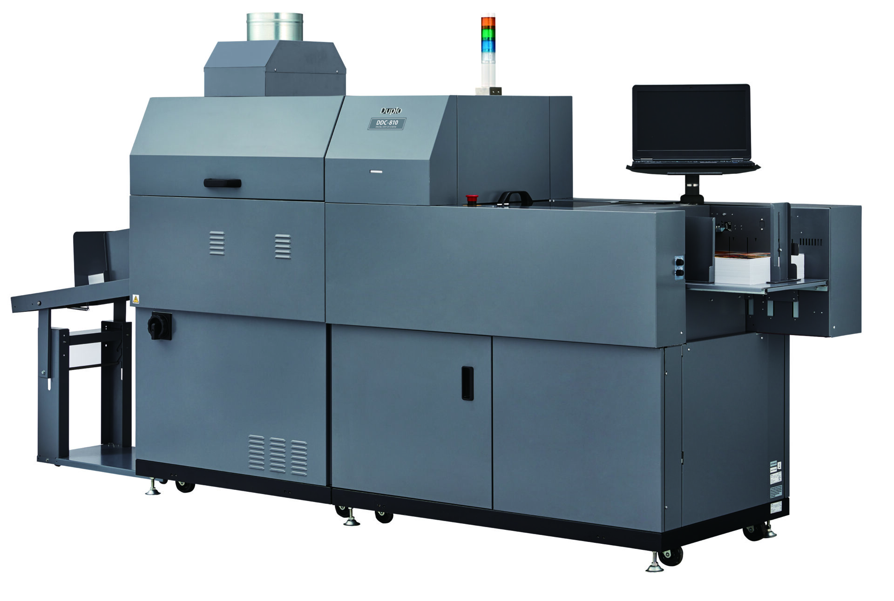

#### Genel Bakış
DuSense DDC-810, kalıp, serigrafi ipeği veya klişe masrafı olmadan dijital ve ofset baskılı tabakaların üzerine doğrudan 600 dpi inkjet kafalarla değişken kalınlıkta parlak spot lak uygular. 1 adetten binlerce adede kadar firesiz ve anında kuruyan baskı süsleme çözümü sunar.

- **Lak Kalınlığı:** 20 ila 80 mikron arasında tek geçişte kademeli kabartma ve doku efektleri.
- **CCD Kamera Pozalama:** Baskı esnasında oluşan kağıt çekme/esneme hatalarını mikron hassasiyetinde algılayıp lakı tam yerine oturtur.
- **Format:** Maksimum 364 x 740 mm tabaka ebadı (B3+).
- **Hız:** Saatte 1.080 B3 tabakaya varan üretim hızı.
- **Uygulamalar:** Lüks ambalaj, kitap kapakları, kartvizitler, davetiyeler, şarap etiketleri.

---

### 2. DuSense DDC-8000 B2 Formatı Dijital Spot UV Lak & Folyo Sistemi
> **"B2 Ebadında Üst Seviye Dijital Süsleme: 3D Kabartma Lak ve Soğuk Folyo Yaldız"**

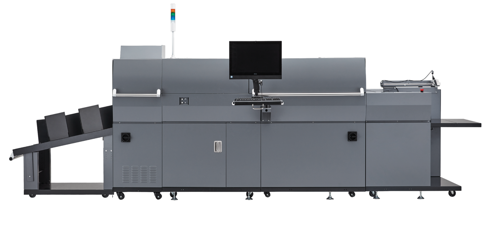

#### Genel Bakış
DDC-8000, ticari ambalaj ve matbaa üreticileri için B2 ebadında geliştirilmiş amiral gemisi süsleme sistemidir. Çift barlı inkjet kafa mimarisi ve entegre soğuk folyo yaldız modülü ile tek geçişte hem kabartmalı lak hem de altın, gümüş ve holografik metalik folyo efektleri uygular.

- **Maksimum Tabaka Boyutu:** 585 x 1068 mm (B2+).
- **Malzeme Gramajı:** 160 ila 600 g/m² kalın karton ve lamine tabakalar.
- **Otomatik Yükseklik & Kalınlık Dedektörü:** Farklı yüzey pürüzlülüklerine anında adapte olan akıllı kafa koruması.
- **Kullanım Alanları:** Kozmetik kutuları, çikolata kutuları, lüks yayıncılık, sert kapak tasarımları.

---

# BÖLÜM 2: ÇOK İŞLEVLİ KESİM, KIRIM & PİLYAJ SONLANDIRMA (SLITTER / CUTTER / CREASER)

---

### 3. Duplo DC-618 Çok İşlevli Sonlandırma Sistemi
> **"Kompakt Alanda Tek Geçişte 6 Boy Kesim, 30 Kırım ve Çatlamasız Katlama"**

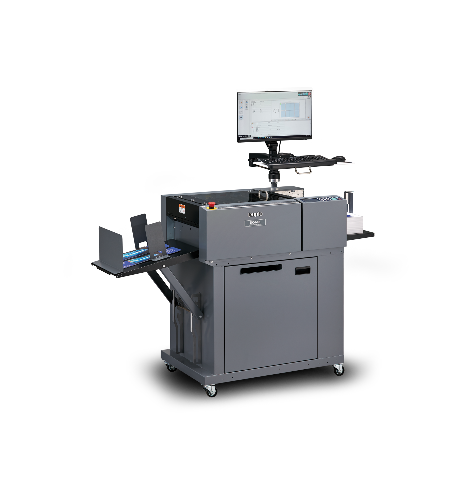

#### Genel Bakış
DC-618, dijital baskı merkezlerinin en popüler çok işlevli sonlandırıcısıdır. Giyotin ve manuel pilyaj makinelerine duyulan ihtiyacı ortadan kaldırarak tek tabakadan kartvizit, menü ve broşürleri otomatik olarak çıkarır.

- **Hız:** Dakikada 50 tabakaya kadar üretim kapasitesi.
- **İşlem Yeteneği:** 6 boy dilimleme, 30 en kesim, 20 derin pilyaj.
- **Barkod Okuyucu:** Baskı üstündeki barkodu okuyarak bıçakları sıfır bekleme süresiyle otomatik ayarlar.
- **Maksimum Kağıt Ebadı:** 370 x 750 mm (1200 mm uzun tabaka opsiyonu).

---

### 4. Duplo DC-648 Yüksek Hızlı Ticari Çok İşlevli Sonlandırıcı
> **"Genişletilmiş Modüler Seçenekler, Döner Kesim ve Kesintisiz Verimlilik"**

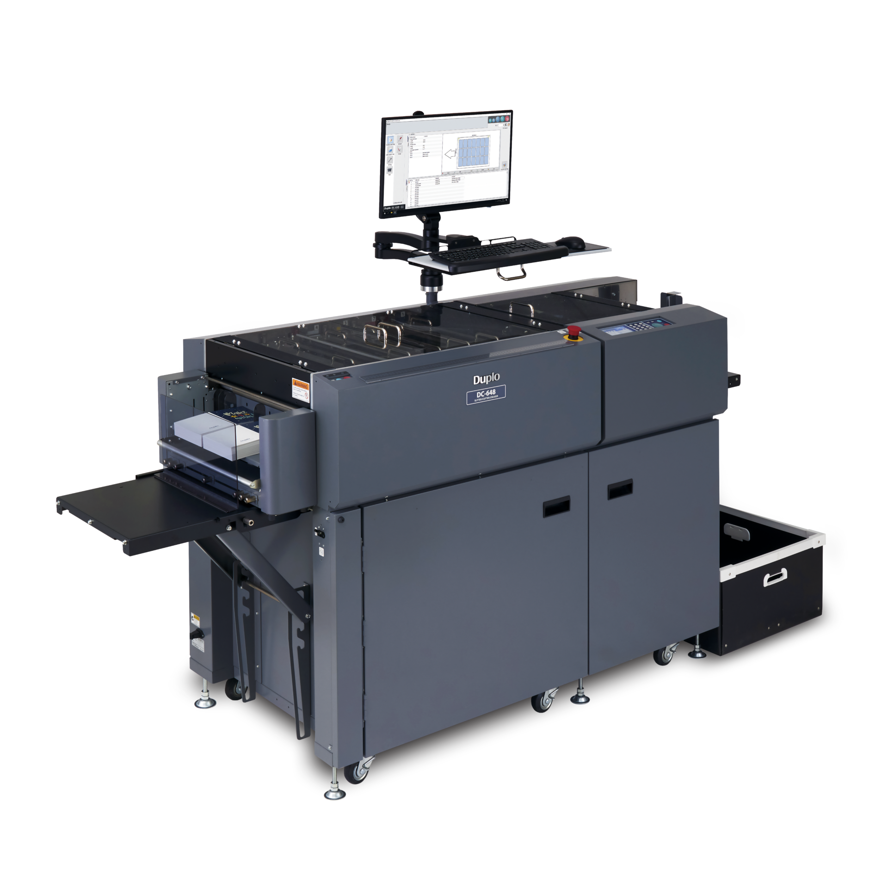

#### Genel Bakış
DC-648; yüksek tirajlı ticari dijital matbaalar için tasarlanmış, döner perforasyon, mikro-perforasyon ve bölümlü kırım kasetleri ile donatılabilen gelişmiş sonlandırma çözümüdür.

- **Hız:** Dakikada 40 tabaka (SRA3 üzerinde çoklu kartvizit/menü).
- **Maksimum Tabaka Ebadı:** 370 x 1000 mm banner formatı.
- **Gramaj:** 110 - 400 gsm arası ağır kuşe ve özel kartonlar.
- **Atık Ayrıştırma:** Çıkan artık kenar şeritlerini otomatik olarak dahili çöp haznesine tahliye eder.

---

### 5. Duplo DC-746 Üst Seviye Ağır Hizmet Sonlandırma Sistemi
> **"JDF İş Akışı Uyumlu, Maksimum Otomasyonlu Dijital Sonlandırma Merkezi"**

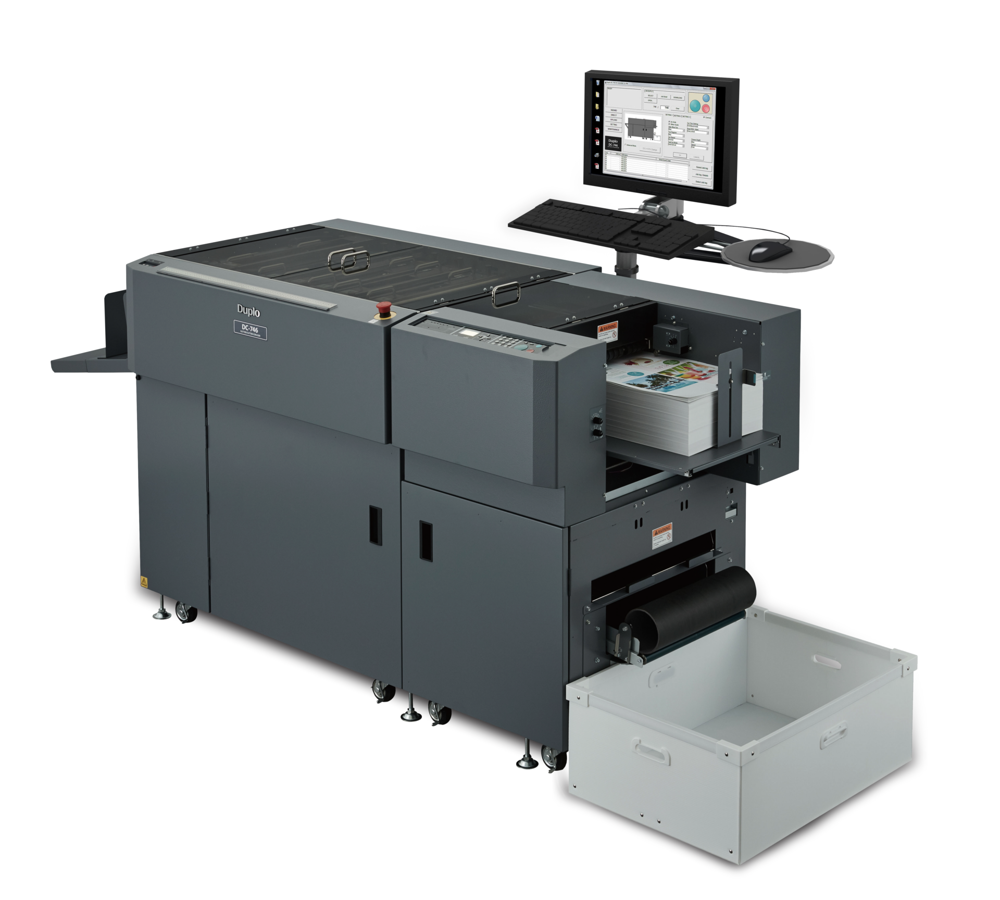

#### Genel Bakış
DC-746, Duplo'nun slitter/cutter/creaser ailesindeki en güçlü endüstriyel modelidir. HP Indigo, Xerox ve Ricoh gibi yüksek hacimli preslerle tam entegre çalışabilir.

- **Hız:** Dakikada 50 tabaka (yüksek hassasiyet modunda).
- **Modüler Kaset Mimarisi:** Kartvizit kesici, kupon yırtma perforatörü, katlama kasedi saniyeler içinde takılıp çıkarılabilir.
- **Otomatik Kompansasyon:** CCD kamera ile görüntü kaymalarını x ve y ekseninde anında düzeltir.

---

### 6. Duplo DC-20K B2 Cutter Creaser System
> **"B2 Tabakaları Doğrudan Bitmiş Ürüne Dönüştüren Ağır Format Çözüm"**

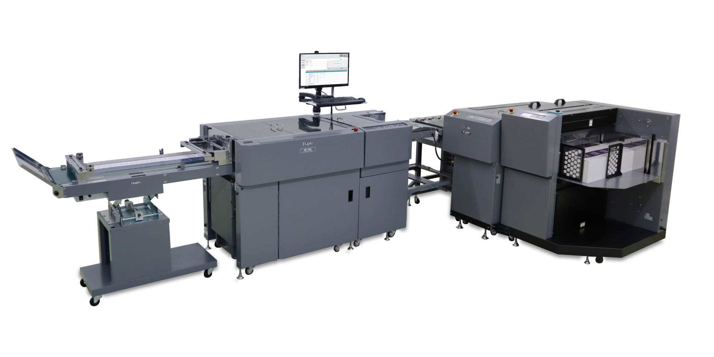

#### Genel Bakış
DC-20K, 750 x 530 mm boyutundaki B2 ofset ve dijital tabakaları giyotine sokmadan önce pilyajlar, boyuna dilimler ve DC sonlandırıcıya besleyerek tek geçişte bitmiş ürüne ulaştırır.

- **Besleme Kapasitesi:** 150 mm istif yüksekliği.
- **Entegrasyon:** DC-746 veya DC-648 ile in-line çalışarak B2 tabakaları küçük parçalara kusursuzca böler.

---

### 7. Duplo DC-F100 In-line Katlama Ünitesi
> **"Pilyajlanmış Tabakaları Duraksamadan Katlayan Akıllı Modül"**

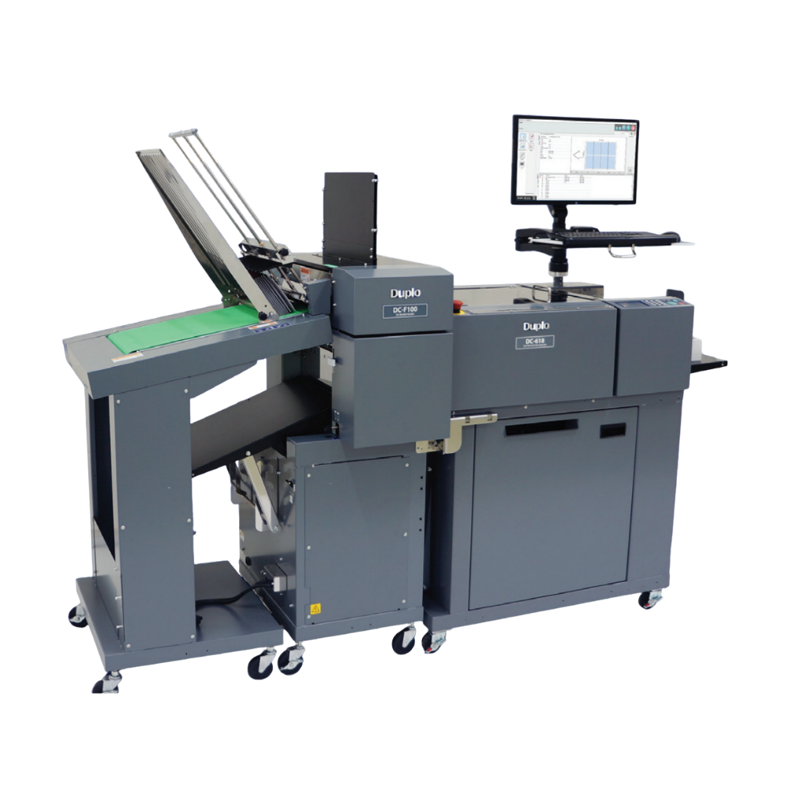

#### Genel Bakış
DC-F100, DC serisi sonlandırıcılara doğrudan bağlanır. Kesilmiş ve derin pilyaj izi açılmış tabakaları tek geçişte mektup, zikzak (akordiyon) veya tek kırım ile katlayarak teslim tablasına aktarır.

---

# BÖLÜM 3: OTOMATİK KİTAPÇIK YAPMA, TEL DİKİŞ & HARMANLAMA SİSTEMLERİ

---

### 8. Duplo DBM-150 Kompakt Kitapçık Yapma Sistemi
> **"Dünyanın En Küçük Tam Otomatik Kitapçık Yapma ve Ön Kesim Ünitesi"**

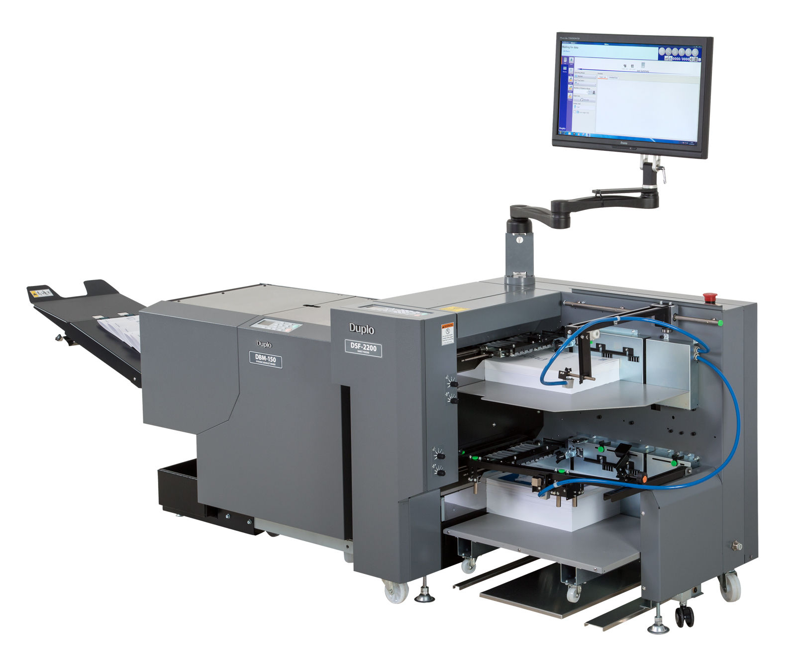

#### Genel Bakış
DBM-150, düşük ve orta hacimli işletmeler, okullar, dernekler ve ofisler için mükemmel bir tak-çalıştır kitapçık yapma çözümüdür.

- **Kapasite:** Saatte 2.400 kitapçık.
- **Sayfa Kalınlığı:** 25 tabakaya kadar (100 sayfa kitapçık).
- **Boyutlar:** A3, A4, A5 ve özel boyutlu kitapçıklar.
- **Otomatik Ayar:** Dokunmatik panelden seçilen ebat için dikiş kafaları ve katlama merdaneleri otomatik pozisyon alır.

---

### 9. Duplo DBM-350 Orta & Yüksek Hacimli Otomatik Kitapçık Sistemi
> **"Yoğun Dijital Baskı Merkezleri İçin Ağır Hizmet Tipi Tel Dikiş ve Kesim"**

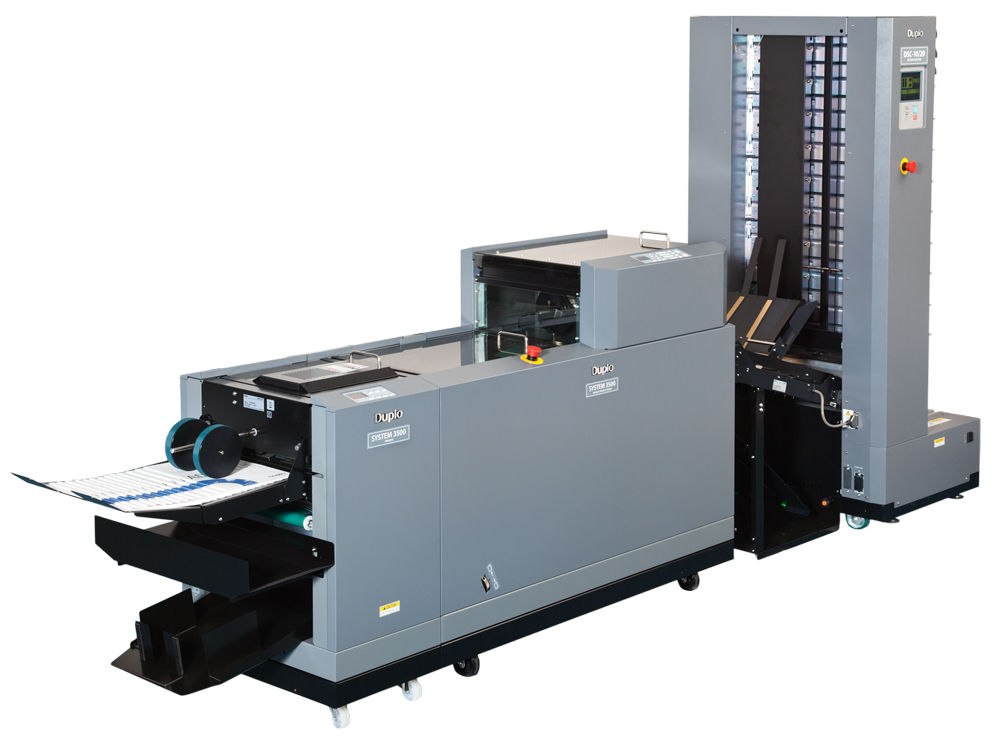

#### Genel Bakış
DBM-350, dijital tabakalardan gelen değişken verili işleri hızla zımbalayan ve ön traşlamasını yaparak pürüzsüz kenarlı kitapçıklar teslim eden sağlam bir üretim hattıdır.

- **Kapasite:** Saatte 3.000 kitapçık.
- **Dikiş Kalınlığı:** 30 tabakaya kadar (120 sayfa).
- **Dayanıklı Dikiş Kafaları:** Ağır gramajlı kuşe kapakları dahi zahmetsizce delip geçen çelik dikiş mekanizması.

---

### 10. Duplo DBM-700 Booklet Making System
> **"Saatte 5.200 Kitapçık, 50 Tabaka (200 Sayfa) Kalın Dikiş Gücü ve Kare Sırt"**

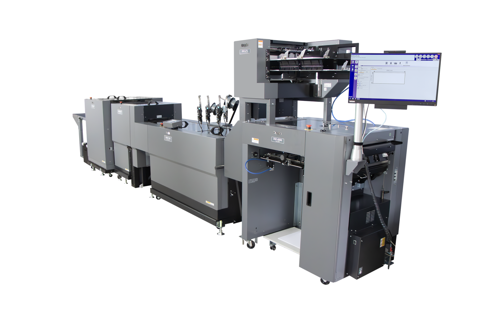

#### Genel Bakış
DBM-700, Duplo'nun amiral gemisi kitapçık yapma hattıdır. Dergiler, yıllıklar, ürün katalogları ve kalın kullanım kılavuzları için endüstri lideri performans sunar.

- **Maksimum Üretim:** Saatte 5.200 kitapçık.
- **Maksimum Kalınlık:** 50 tabaka (200 sayfa dikiş + katlama).
- **Kare Sırt Aparatı (Square Spine):** Tel dikişli kitapçıklara Amerikan cilt sırtı görünümü kazandırarak sırt üzerine başlık basılmasına imkan verir.
- **Maksimum Kağıt Formatı:** 356 x 650 mm tabaka besleme desteği.

---

### 11. Duplo iSaddle Range (Eyer Tipi Dikiş Sistemi)
> **"Düz Yataklı A4 Yatay Kitapçık Desteği ve Geleneksel Eyer Tipi Dikiş Hassasiyeti"**

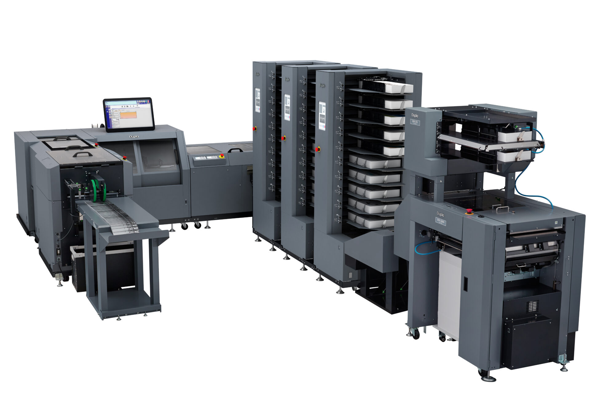

#### Genel Bakış
iSaddle, geleneksel eyer tipi (saddle stitcher) mekaniğini modern dijital otomasyon ile birleştiren benzersiz bir sistemdir. Tabakaları sırtından katlayıp eyer üzerinde tel dikiş atarak kalın kuşe kataloglarda sıfır kavis ve mükemmel düzlük sağlar.

- **A4 Yatay (Landscape) Kitapçık:** Mimari kataloglar ve fotoğraf albümleri için popüler olan A4 yatay formatını tam hızda işler.
- **Harmanlama Kuleleri Entegrasyonu:** DSC-10/60i vakumlu harmanlama kuleleri ile ofset ve dijital tabakaları birlikte besleyebilir.

---

# BÖLÜM 4: DİJİTAL KESİM MASALARI & KALIP KESİM SİSTEMLERİ

---

### 12. Duplo PFi Blade B2+ Dijital Düz Kesim Masası
> **"B2 Formatında Kalıpsız, Bıçak Masrafsız Otomatik Dijital Kesim ve Pilyaj"**

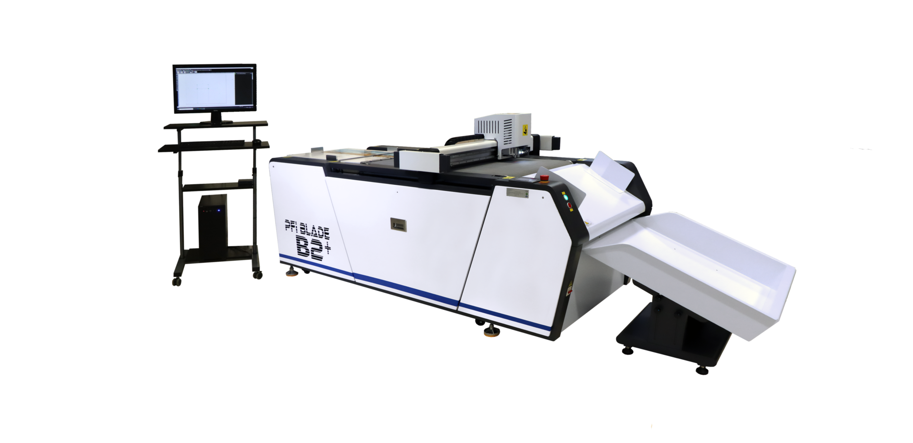

#### Genel Bakış
PFi Blade B2+, pahalı kalıp maliyetleri olmadan özel kutular, ambalaj prototipleri, etiketler ve dekota/foreks paneller üretmek isteyen işletmeler için tasarlanmış çok takımlı dijital sonlandırma masasıdır.

- **Çalışma Alanı:** 800 x 600 mm (B2+ ebadı).
- **Takım Başlığı:** Kesim bıçağı, teğetsel bıçak, pilyaj tekerleği ve çizim kalemi.
- **CCD Kamera:** Baskı kayıt işaretlerini otomatik okuyarak kesim çizgisini baskıyla %100 örtüştürür.
- **İşlenebilir Malzemeler:** Oluklu mukavva, kuşe karton, köpük, PVC, lamine levhalar, kendinden yapışkanlı folyolar (1.5 mm kalınlığa kadar).

---

### 13. Duplo PFi Blade B3+ Dijital Kesim Masası
> **"Kompakt Boyutta Hızlı Prototipleme, Kısa Tiraj Ambalaj ve Etiket Üretimi"**

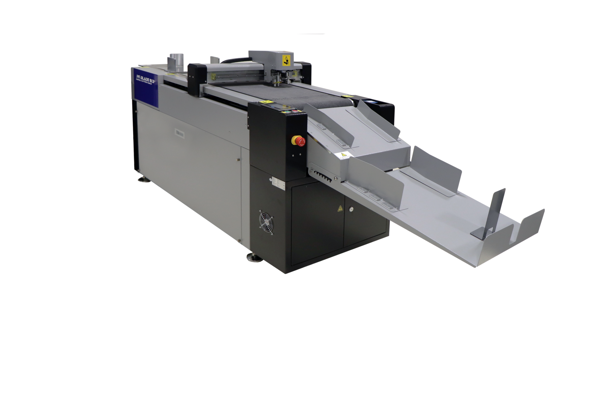

#### Genel Bakış
PFi Blade B3+, küçük ve orta ölçekli matbaalar için B3 formatında (600 x 400 mm) ekonomik, hassas ve tam otomatik vakumlu tabla beslemeli kesim masasıdır.

- **Besleme Kapasitesi:** 100 mm yüksekliğinde otomatik tabaka yükleme.
- **Kesim Hızı:** 1200 mm/saniye maksimum kafa hızı.

---

### 14. Duplo PFi DiCut 310 Döner Manyetik Kalıplı Kesim Makinesi
> **"Saatte 4.000 Tabaka Hızında Döner Kalıp Kesim, Etiket ve Kart Üretimi"**

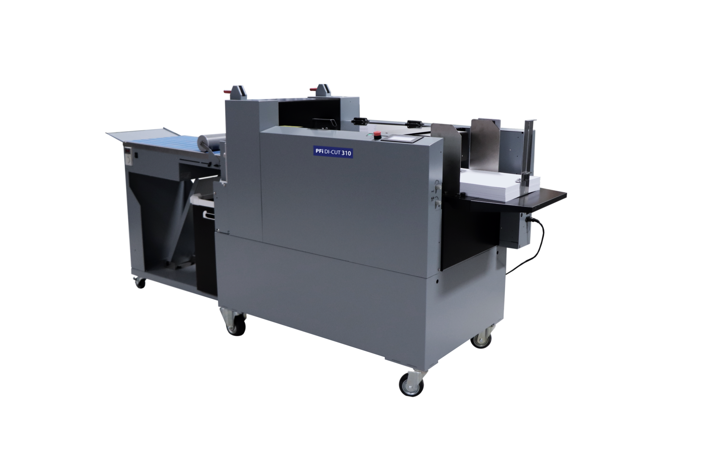

#### Genel Bakış
PFi DiCut 310, esnek manyetik kalıplar kullanarak yüksek hızda şekilli kartvizit, yuvarlak köşeli kartlar, etiketler ve açılır pencereli ambalajlar üreten kompakt döner kesicidir.

- **Hız:** Saatte 4.000 tabaka.
- **Format:** Maksimum 330 x 500 mm.
- **Özellik:** Kesilen parçaları artık çerçeveden ayıran entegre atık ayıklama ünitesi.

---

### 15. Duplo DSM-1000 B2 Die Cutter (Kalıp Kesim Sistemi)
> **"B2 Formatında Yüksek Hassasiyetli Çelik Kurallı Kalıp Kesim ve Kabartma"**

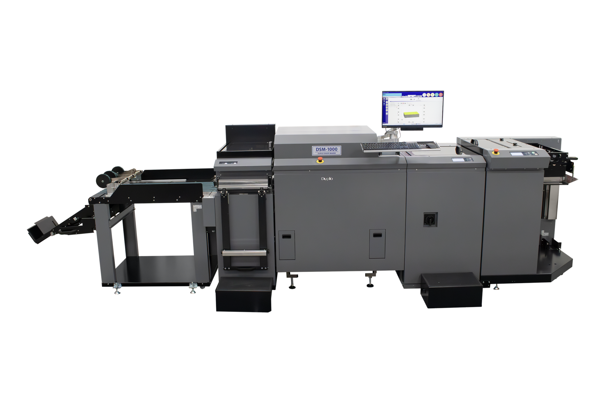

#### Genel Bakış
DSM-1000 B2 Die Cutter; cepli klasörler, lüks ambalaj kutuları ve perakende teşhir ürünleri için geleneksel çelik kalıplarla çalışan endüstriyel kalıp kesim ve gofre kabartma sistemidir.

- **Maksimum Tabaka:** 530 x 750 mm (B2).
- **Hız:** Saatte 2.500 tabaka.
- **Otomatik İstif:** Yüksek kapasiteli paletli besleme ve çıkış tablası.

---

# BÖLÜM 5: PROFESYONEL KAĞIT KATLAMA MAKİNELERİ (FOLDER RANGE)

---

### 16. Duplo DF-850 Masaüstü Sürtünmeli Katlama Makinesi
> **"Kullanımı Kolay, Kompakt ve Dakikada 241 Sayfa Katlama Hızı"**

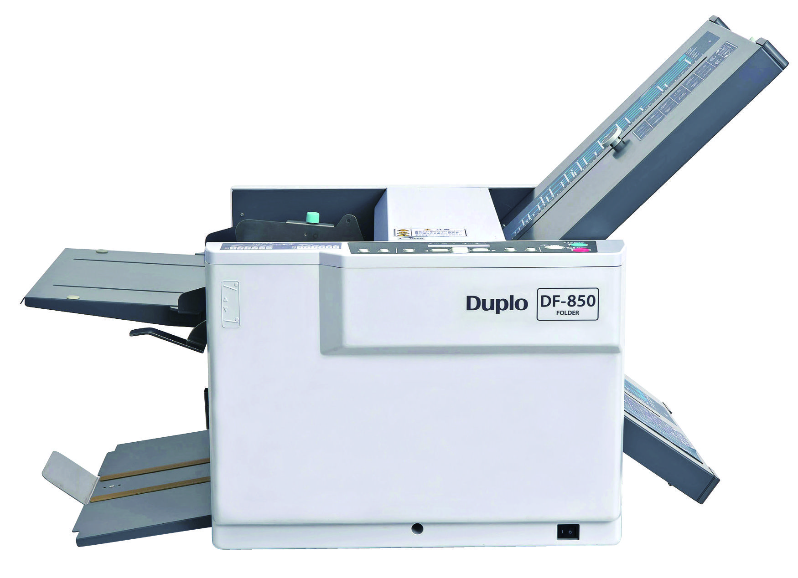

- **Hız:** Dakikada 241 sayfa (A4 tek kırım).
- **Kağıt Ebadı:** A3'ten A6'ya kadar.
- **Katlama Çeşitleri:** Tek kırım, mektup kırım, akordeon, çift kırım, kapı kırım ve özel kırım.
- **Özellik:** Sessiz çalışma ortamı, fatura ve kurumsal bülten katlamada ideal.

---

### 17. Duplo DF-870 Otomatik Ayarlı Katlama Makinesi
> **"Tek Tuşla Otomatik Çanta Ayarı ve Hızlı Ebat Değişimi"**

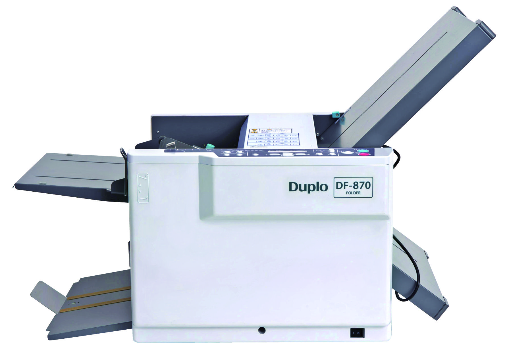

- **Hız:** Dakikada 241 sayfa.
- **Otomasyon:** Seçilen kağıt boyutu ve katlama tipine göre katlama plakalarını motorlu sistemle otomatik ayarlar.
- **Hafıza:** Sık kullanılan özel katlama tipleri için kullanıcı hafızası.

---

### 18. Duplo DF-990 Profesyonel Masaüstü Katlama Makinesi
> **"Dakikada 260 Tabaka Rekor Hız ve Çift Kağıt Besleme Dedektörü"**

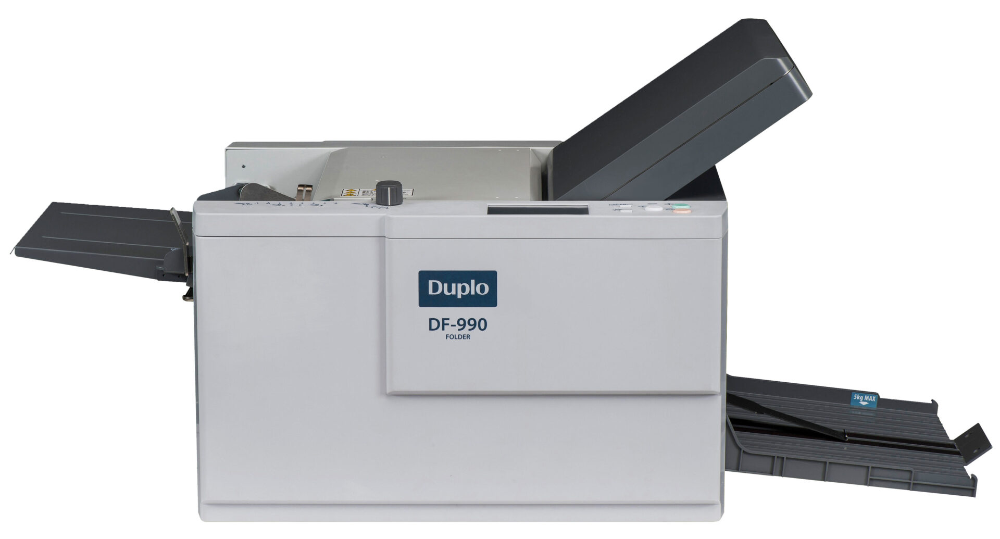

- **Hız:** Dakikada 260 tabaka ile sınıfının en hızlısı.
- **Çift Kağıt Sensörü:** Statik elektrikli dijital kağıtlarda çift beslemeyi algılayıp sistemi durdurur.
- **Ses İzolasyonu:** Özel kapak yapısı sayesinde açık ofislerde dahi gürültüsüz çalışır.

---

### 19. Duplo DF-999 Dokunmatik Ekranlı Katlama Makinesi
> **"Renkli Dokunmatik Ekran, Ultrasonik Çift Tabaka Algılama ve Akıllı Katlama"**

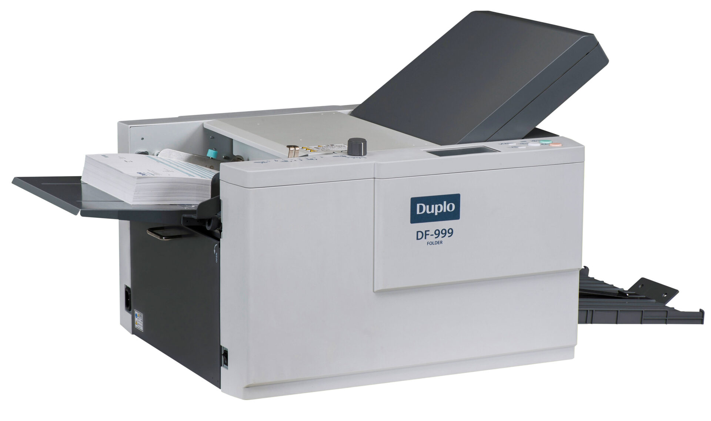

- **Dokunmatik Ekran:** Kullanıcı dostu grafik renkli LCD arayüz.
- **Ultrasonik Sensör:** Farklı gramaj ve renkteki kağıtlarda şaşmayan ultrasonik kalınlık kontrolü.
- **Kapasite:** 500 tabakalık derin besleme tepsisi.

---

### 20. Duplo DF-1300L Uzun Tabaka Hava Emişli Katlama Makinesi
> **"648 mm Uzun Tabaka Desteği ve Kuşe Kağıtlar İçin Çiziksiz Vakumlu Besleme"**

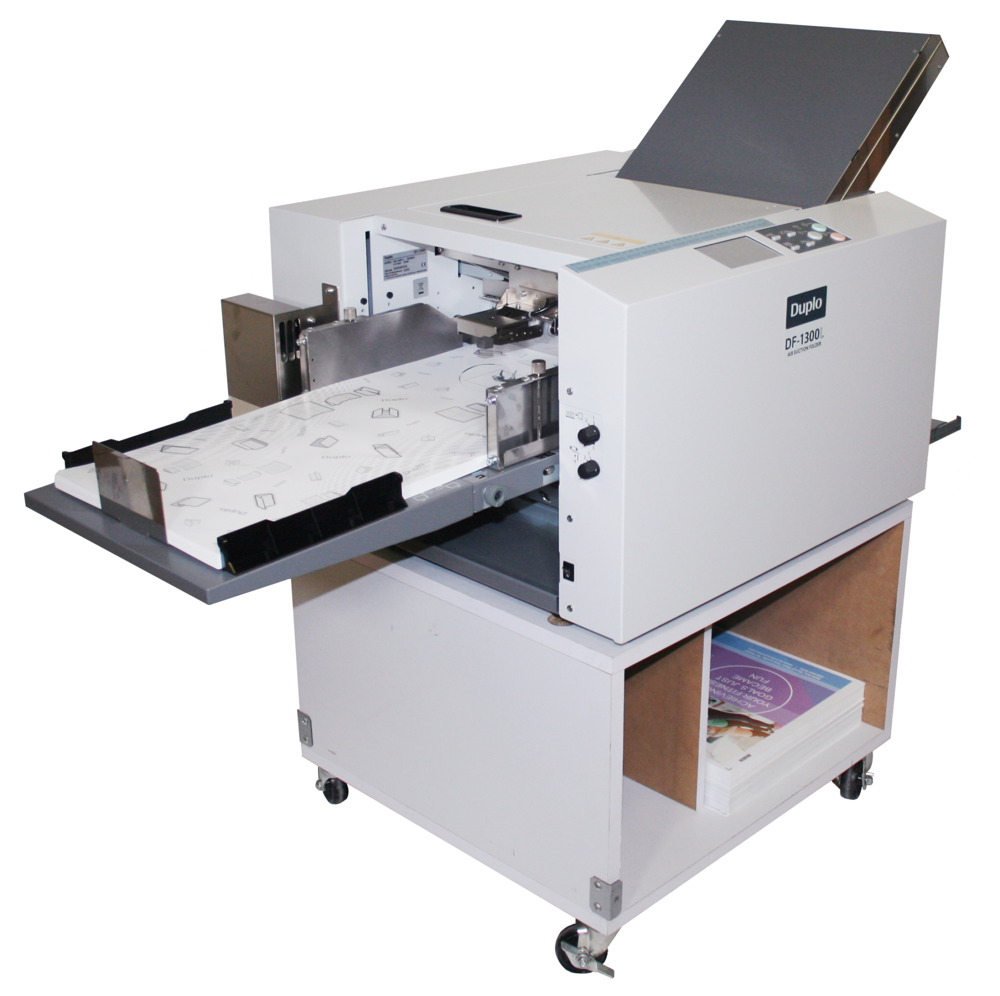

- **Hava Emişli (Vakumlu) Besleme:** Sürtünmeli tekerleklerin kuşe kağıtlarda bıraktığı toner çiziklerini tamamen engeller.
- **Uzun Tabaka Desteği:** 311 x 648 mm ebadına kadar uzun 6 sayfalık (6-panel) A4 akordiyon broşürleri tek seferde katlar.
- **Hız:** Dakikada 310 tabakaya kadar yüksek debi.

---

# BÖLÜM 6: AMERİKAN CİLT KAPAK TAKMA SİSTEMLERİ

---

### 21. Duplo PFi BIND 2100 PUR Otomatik Amerikan Ciltleme Makinesi
> **"Patentli Orbital PUR Sistemi İle Sıfır Temizlik ve Kopmaz Cilt Gücü"**

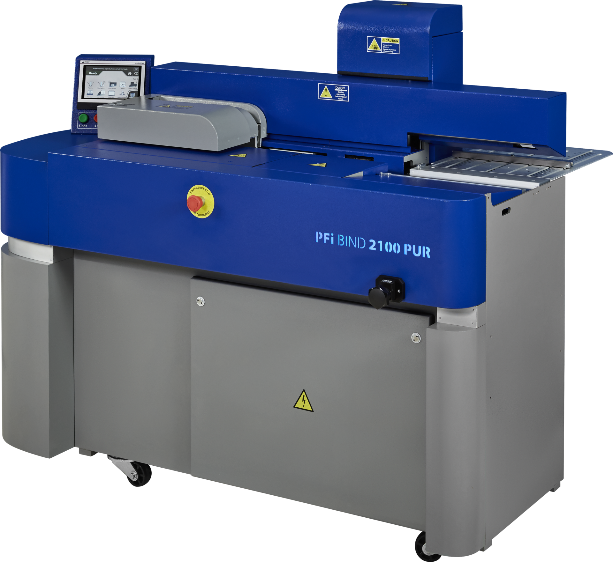

#### Genel Bakış
PFi BIND 2100 PUR; zorlu dijital tonerli, laklı veya sentetik kağıtları ömür boyu kopmayacak şekilde yapıştıran dünyanın en kullanıcı dostu kompakt PUR ciltleme makinesidir.

- **Patentli Orbital PUR Nozül Sistemi:** Açık tutkal haznesi yerine kapalı tüp sistemi kullanır. Her gün saatlerce temizlik yapma zorunluluğunu ortadan kaldırır.
- **Hız:** Saatte 290 kitaba varan üretim kapasitesi.
- **Kitap Kalınlığı:** 1 mm'den 40 mm'ye kadar (10 sayfadan 800 sayfaya kadar).
- **Otomatik Kapak Takma:** Kapak beslemesini otomatik yapar, sırt pilyajlarını kitap kalınlığına göre anında kendisi ayarlar.
- **Uygulamalar:** Fotoğraf kitapları, yıllıklar, üniversite tezleri, kurumsal raporlar, lüks edebi yayınlar.

---

### 🏢 Lidya Grup Satış Sonrası ve Teknik Hizmet Güvencesi
- **Türkiye Distribütörü:** Lidya Grup teknik ekibi tarafından kurulum, operatör eğitimi ve kalibrasyon.
- **Yedek Parça ve Sarf Deposu:** Orijinal PUR tutkallar, lak vernikleri, kesim bıçakları ve yedek kasetler Türkiye stoklarından temin edilir.
- **İletişim:** 0542 352 72 99 | yasin.albostanli@lidyagrup.com.tr
