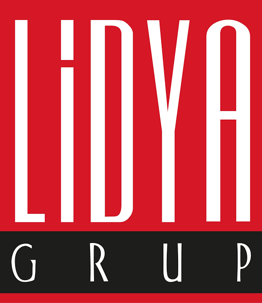
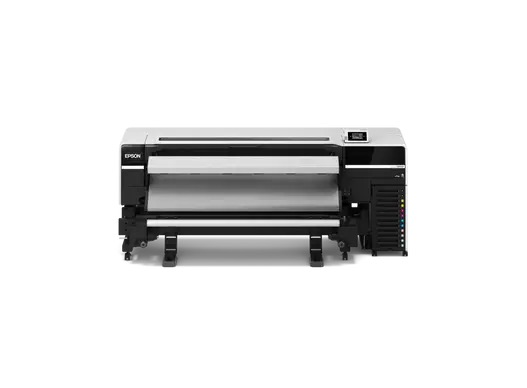

# LIDYA GRUP | EPSON GENİŞ FORMAT YAZICI SİSTEMLERİ ÜRÜN BROŞÜRÜ

  

**Endüstriyel Eko-Solvent Signage & CAD / Teknik Çizim ve Poster Çözümleri**  
*Web: [www.lidyagrup.com.tr](https://www.lidyagrup.com.tr) | İletişim: 0542 352 72 99 | E-posta: yasin.albostanli@lidyagrup.com.tr*  
*Genel Merkez: Şerifali Mah. Şehit Sok. No: 6 Ümraniye / İstanbul*

---

## 1. Epson SureColor SC-S Serisi (SC-S9100 / SC-S8100 / SC-S7100)
> **"Tabela, Reklam ve Araç Giydirmede Zirve Renk Doğruluğu ve Çevre Dostu Eko-Solvent"**

### Genel Bakış
Epson’un yeni nesil SureColor SC-S serisi, iç ve dış mekan reklamcılığında dünya lideri renk gamutu, fotogerçekçi baskı kalitesi ve düşük sahip olma maliyetini bir araya getirir.

### Öne Çıkan Özellikler
- **Yeni Nesil PrecisionCore® Micro TFP Kafalar:** Mikroskobik damla kontrolü ile sıfır çizgi hatası ve mükemmel renk geçişleri.
- **UltraChrome GS3 / 10 Renk Mürekkep Seti:** Kırmızı (Red), Turuncu (Orange), Açık Siyah (Light Black) ve Çift Beyaz / Metalik Gümüş desteği ile Pantone renklerinin %98.2'sine ulaşma başarısı.
- **Düşük Koku ve GreenGuard Gold Sertifikası:** İç mekanlarda, hastanelerde ve okullarda güvenle kullanılabilen kokusuz çevre dostu mürekkepler.
- **Gelişmiş Otomatik Gergi Kontrolü (AD-ATC):** Ağır vinil rulolarında bile milimetrik besleme kararlılığı.

### Uygulama Alanları
Lüks araç giydirme folyoları, ışıklı kutu kumaşları (backlit), vitrin afişleri, güzel sanatlar (fine art) kanvas tabloları, duvar kağıtları.

---

## 2. Epson SureColor SC-T Serisi (SC-T3405 / SC-T5405 / SC-T3100M-MFP)
> **"Mimarlık, Mühendislik, Haritacılık ve Perakende İçin Profesyonel CAD & Poster Baskısı"**

### Genel Bakış
Teknik çizimler (CAD), CBS (GIS) haritaları, mimari planlar, inşaat projeleri ve perakende satış afişleri için yüksek hız, keskin çizgi hassasiyeti ve suya dayanıklı baskılar sunar.

### Öne Çıkan Özellikler
- **UltraChrome XD2 Pigment Mürekkep:** Çizimler üzerine su damladığında veya fosforlu kalemle çizildiğinde dağılmayan ve solmayan pigment yapısı.
- **Yüksek Hız:** Bir adet A1 teknik çizimi sadece **22 ila 24 saniyede** basabilme.
- **Kompakt ve Şık Tasarım:** Ofis ortamlarına kolayca uyum sağlayan sessiz ve az yer kaplayan gövde.
- **Entegre Geniş Format Tarayıcı (SC-T3100M / SC-T5100M):** Eski mimari paftaları tek tuşla 600 dpi çözünürlükte tarama ve anında kopyalama (MFP).
- **Wi-Fi ve Mobil Baskı:** Bilgisayar, tablet veya akıllı telefondan doğrudan kablosuz çizim gönderme desteği.

---
*Lidya Grup teknik eğitim, kurulum, orijinal Epson kartuş ve medya tedariki ile tam destek sunar.*

