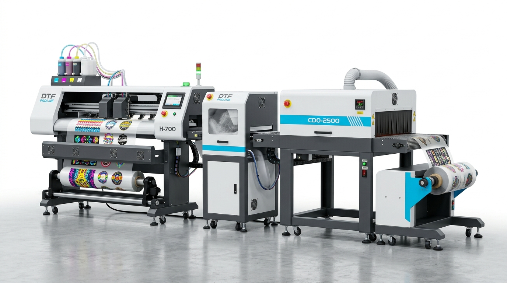
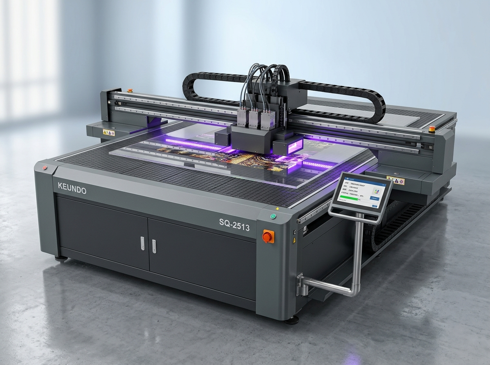

# LIDYA GRUP | SUTEC DİJİTAL BASKI SİSTEMLERİ ÜRÜN BROŞÜRÜ

  

**Lidya Grup Öz Markası: Tekstil DTF ve Özel Konfigürasyonlu Endüstriyel UV Baskı Teknolojileri**  
*Web: [www.lidyagrup.com.tr](https://www.lidyagrup.com.tr) | İletişim: 0542 352 72 99 | E-posta: yasin.albostanli@lidyagrup.com.tr*  
*Genel Merkez: Şerifali Mah. Şehit Sok. No: 6 Ümraniye / İstanbul*

---

## 1. Sutec DTF 3200 (Direct-to-Film) Tekstil Baskı Çözümü
> **"Her Türlü Kumaşa Kusursuz, Dayanıklı ve Esnek Dijital Transfer Baskı"**

### Genel Bakış
Sutec DTF 3200, Lidya Grup'un pazar ihtiyaçlarına özel olarak tasarladığı; pamuklu, polyester, ipek, kot (denim), deri ve karışımlı kumaşlar dahil tüm tekstil ürünlerine kalıpsız, ayıklamasız doğrudan transfer baskı sağlayan kompakt bir üretim hattıdır.

### Öne Çıkan Özellikler
- **Entegre Üretim Hattı:** Baskı ünitesi, otomatik sıcak tutkal tozu serpme, kızılötesi (IR) fırınlama ve soğutma sarma ünitesi tek bir gövdede senkronize çalışır.
- **Epson i3200 Piezo Baskı Kafaları:** Canlı renkler ve keskin beyaz alt zemin baskısı.
- **Aktif Beyaz Boya Sirkülasyonu:** Beyaz mürekkebin çökmesini engelleyerek her sabah anında baskıya başlama olanağı.
- **Yüksek Yıkama Dayanımı:** 60°C'de defalarca yıkamaya, esnetmeye ve sürtünmeye dayanıklı elastik baskı sonucu.
- **Sıfır Ayıklama (Weeding Yok):** Flekso transfer folyolarındaki gibi ayıklama zahmetine son; sadece basılan grafik kumaşa geçer.

### Uygulama Alanları
Tişörtler, sweatshirtler, formalar, şapkalar, bez çantalar, ayakkabılar, iş elbiseleri, montlar ve spor giyim ürünleri.

---

## 2. Sutec Endüstriyel Flatbed UV Serisi
> **"Yüksek Hassasiyet, Güvenilir Şasi ve Rekabetçi Üretim Maliyeti"**

### Genel Bakış
Lidya Grup güvencesiyle sunulan Sutec Flatbed UV serisi, promosyonel ürün üreticileri, tabelacılar ve mobilya atölyeleri için dayanıklı mekanik şasi ve yüksek çözünürlüklü UV LED teknolojisini ekonomik işletim maliyetleriyle buluşturur.

- **Kullanım Malzemeleri:** Ahşap, cam, deri, pleksi, dekota, kompozit panel, telefon kılıfı, promosyon kalem, ajanda ve ödül plaketleri.
- **Lidya Grup Güvencesi:** %100 yerel teknik servis, hızlı parça ve boya tedariki garantisi.

---
*Lidya Grup güvencesiyle sektörün hizmetinde.*

